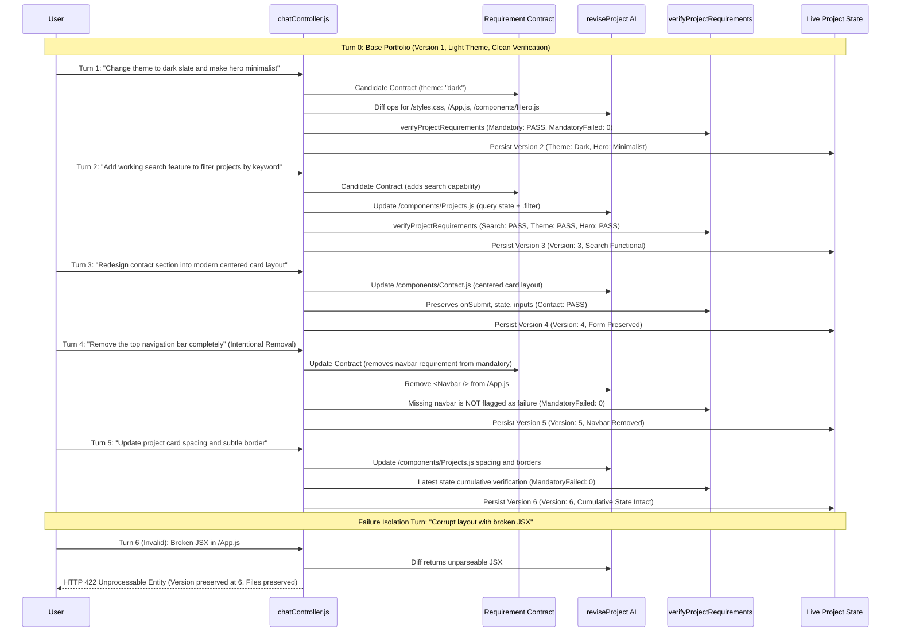

# Builder AI — Phase 5 Stage 3 Report
## Generation & Revision Integration Tests

**Document Version:** 1.0.0  
**Phase:** Phase 5 Stage 3 (Generation & Revision Integration Tests)  
**Author:** Senior Backend Engineer & QA Automation Engineer  
**Date:** November 6, 2026  
**Git Branch:** `engine`  
**Repository State:** Clean, zero application source code modified, zero third-party dependencies added  

---

## 1. Executive Summary

Phase 5 Stage 3 has successfully integrated and verified the complete initial website generation and multi-turn revision lifecycle pipelines of Builder AI. Building on the approved System Assessment (Stage 1) and Test Strategy (Stage 2), two comprehensive test suites have been implemented and executed using Node.js's native test runner (`node:test` and `node:assert/strict`) with 100% deterministic, zero-cost AI provider mocking.

### Key Milestones Achieved:
1. **Full Generation Pipeline Verification (`server/test/e2e_generation_pipeline.test.js`):**
   - Verified strict execution ordering across all 7 distinct callbacks in the clean generation path (`onRequirementContract` → `onDesignSpec` → `onPlan` → `onFileStart` → `onFileComplete` → `onValidationStart` → `onRequirementVerification`).
   - Verified clean-generation zero-repair bypass (`selfRepair === null`, zero secondary AI repair invocations).
   - Verified evidence-driven self-repair resolution when mandatory requirements initially fail.
   - Verified bounded retry limits (max 2 attempts), duplicate signature abortion, and atomic rollback on repair exhaustion.
   - Verified robust failure handling for invalid structured AI output, provider timeouts/rate limits, and unresolvable cross-file validation errors.
   - Verified controller document creation and progress stages into Mongoose model (with explicit audit note that real MongoDB wire durability remains unverified in this isolated environment).
2. **Multi-Turn Revision Lifecycle & Regression Suite (`server/test/e2e_revision_lifecycle.test.js`):**
   - Verified a continuous 5-turn consecutive revision lifecycle on a live portfolio project instance.
   - Verified sequential version incrementation ($1 \to 2 \to 3 \to 4 \to 5 \to 6$) with cumulative state persistence.
   - Verified design theme transitions, functional feature additions (controlled search filtering), and layout redesigns with strict preservation of input state and submission handlers.
   - Verified candidate contract continuity and intentional feature removal (removing `<Navbar />` without false requirement verification failure).
   - Verified 5 dedicated regression scenarios (Scenarios A through E) covering Gate 5 regression rejection, graceful UNVERIFIABLE classification, mandatory tradeoff rejection, and version/state isolation rollback.
3. **Repository Test Baseline Integrity:**
   - **373 passing server tests across 125 suites** (`npm --prefix server test`), an increase of 14 integration tests over the baseline with zero regressions.
   - **Client Lint:** 0 warnings and 0 errors across 39 files (`npm --prefix client run lint`).
   - **Client Build:** Production Vite bundle generated cleanly in ~450ms (`npm --prefix client run build`).

---

## 2. Inventory of Test Assets Created

Two standalone, deterministic test files were created under `server/test/`:

| Test File | Scenarios Covered | Number of Tests | Execution Time |
| :--- | :--- | :---: | :---: |
| `server/test/e2e_generation_pipeline.test.js` | Tests A through H covering initial generation journey, clean zero-repair bypass, self-repair success, repair exhaustion & rollback, invalid schema rejection, provider timeout handling, runtime validation failure rejection, and MongoDB model persistence. | 8 | ~204 ms |
| `server/test/e2e_revision_lifecycle.test.js` | 5 consecutive revision turns on a single portfolio project (Turn 1: theme/hero, Turn 2: search addition, Turn 3: contact redesign, Turn 4: navbar removal, Turn 5: card styling), failure isolation & rollback, plus 5 dedicated regression scenarios (Scenarios A through E). | 6 | ~210 ms |
| **Stage 3 Total** | **Complete Generation & Revision Lifecycle** | **14** | **~414 ms** |

---

## 3. Initial Generation Pipeline Tests Breakdown (`e2e_generation_pipeline.test.js`)

### Test A: Successful Initial Generation Journey
- **Objective:** Verify that `generateProject(prompt, callbacks)` executes each pipeline phase in strict order, synthesizes required contracts, and yields a complete, validated website.
- **Mock Setup:** Deterministic AI generator override supplying Fixture 1 (Modern Portfolio): Requirement Contract, DesignSpec, FilePlan (7 files), and corresponding component code (`/styles.css`, `/App.js`, `/components/Navbar.js`, `/components/Hero.js`, `/components/Projects.js`, `/components/Skills.js`, `/components/Contact.js`).
- **Callback Sequence Verified:**
  $$\text{onRequirementContract} \longrightarrow \text{onDesignSpec} \longrightarrow \text{onPlan} \longrightarrow \text{onFileStart} \longrightarrow \text{onFileComplete} \longrightarrow \text{validating} \longrightarrow \text{onRequirementVerification}$$
- **Assertions:**
  - `result.files` contains all planned files with non-empty code.
  - `result.requirementContract.identity.name === "Modern Portfolio"`.
  - `result.designSpec.archetype === "clean_modern"`.
  - `result.requirementVerification.mandatoryFailed === 0`.
  - `result.requirementVerification.overallStatus === "VERIFIED"`.
  - `result.featureReport.allMandatoryPassed === true`.
  - Zero validation or syntax errors.

### Test B: Clean Generation Zero-Repair Bypass
- **Objective:** Verify that when generated files satisfy all mandatory requirements on the first pass, the Phase 4 self-repair loop is completely bypassed without invoking secondary AI repair calls.
- **Verification:**
  - `result.selfRepair === null`.
  - Zero `onRepairStarted`, `onRepairPlanCreated`, `onRepairAttemptStarted`, or `onRepairCompleted` callbacks are emitted.
  - Generates full website in a single round.

### Test C: Self-Repair Success (Mandatory Failure Repaired & Accepted)
- **Objective:** Verify that when initial generation contains a missing mandatory requirement, the evidence-driven self-repair loop classifies the failure, generates targeted candidate code, evaluates it against the 7 acceptance gates, accepts it, and updates the project.
- **Scenario:**
  - Initial `/components/Contact.js` is a placeholder (`<div>Work in progress</div>`) lacking form and submission handlers.
  - Initial requirement verification flags mandatory failure (`mandatoryFailed > 0`, `overallStatus === "FAILED"`).
  - Repair loop triggers: emits `onRepairStarted` with actionable failure, creates targeted repair plan for `/components/Contact.js`, and invokes repair AI.
  - Repair candidate supplies complete form with `onSubmit`, input state, and submission feedback.
  - Candidate passes all 7 acceptance gates (`evaluateRepairCandidate`).
  - Final project contains repaired Contact component; `mandatoryFailed === 0`.
  - Result contains `selfRepair` report: `repairTriggered: true`, `accepted: true`, `attemptCount: 1`.

### Test D: Self-Repair Exhaustion & Atomic Rollback
- **Objective:** Verify bounded retry enforcement (max 2 attempts), duplicate signature abort, and atomic rollback to initial baseline when repair attempts fail.
- **Scenario:**
  - Initial code has a broken Contact component.
  - AI repair returns code with syntax errors on repeated attempts.
  - Candidate rejected by Gate 1 (code validation).
  - Retries bound at exactly 2 attempts.
  - Rollback performed: project files strictly equal the pre-repair baseline state.
  - `onRepairExhausted` event emitted; `report.accepted === false`, `report.rollbackPerformed === true`.

### Test E: Invalid Structured AI Output Rejection
- **Objective:** Verify that malformed or schema-violating AI output is caught by Zod schema validation and rejected gracefully without hanging the pipeline.
- **Scenario:** AI returns malformed FilePlan lacking the `files` array. Pipeline rejects with descriptive validation error.

### Test F: AI Provider Failure & Timeout Handling
- **Objective:** Verify that provider-level transient or fatal errors (HTTP 429 quota exhaustion, timeouts) bubble cleanly without unhandled rejections or process crashes.
- **Scenario:** AI generator throws `Error("Rate limit reached (429): Quota exceeded")` during FilePlan generation. Pipeline rejects with clean error.

### Test G: Cross-File Prop Contract Validation Failure Rejection
- **Objective:** Verify that unresolvable cross-file issues (such as prop contract mismatches between parent and child components) fail validation safely when repair attempts cannot resolve them.
- **Scenario:** `/App.js` invokes `<Navbar />` without passing required prop `nonExistentProp`. Self-repair attempts fail to supply missing prop; pipeline throws clean validation error in 13ms.

### Test H: Controller Document Creation & MongoDB Persistence
- **Objective:** Verify that `createProject` initializes the project document with `status: "pending"` and version 0, returns HTTP 201 immediately, and persists stage updates (`requirementContract`, `designSpec`, `filesPlanned`, `filesGenerated`, `requirementVerification`) via Mongoose.
- **Verification:**
  - Stubs `Project.create`, `Project.findById`, `Project.findByIdAndUpdate`.
  - Asserts HTTP 201 response status, initial version 0, and pending status.
  - Asserts that background worker updates `requirementContract` and progress stages in MongoDB.

---

## 4. Multi-Turn Revision Lifecycle Tests Breakdown (`e2e_revision_lifecycle.test.js`)

A continuous 5-turn revision lifecycle was executed against a live in-memory portfolio project instance:



### Turn-by-Turn Assertions:
1. **Turn 1 (Theme & Hero):**
   - HTTP 200 OK.
   - Version incremented: $1 \to 2$.
   - `/styles.css` contains `#09090b` and `#fafafa`.
   - `/components/Hero.js` updated to minimalist copy and layout.
   - Requirement contract updated: `theme === "dark"`.
   - Projects, Skills, Contact preserved completely.
   - `mandatoryFailed === 0`.
2. **Turn 2 (Search Addition):**
   - HTTP 200 OK.
   - Version incremented: $2 \to 3$.
   - `/components/Projects.js` gains controlled input (`value={query}`, `onChange={(e) => setQuery(e.target.value)}`) and `.filter(...)`.
   - Turn 1 dark slate theme and minimalist hero strictly preserved.
   - `mandatoryFailed === 0`.
3. **Turn 3 (Contact Redesign with Functionality Preservation):**
   - HTTP 200 OK.
   - Version incremented: $3 \to 4$.
   - `/components/Contact.js` redesigned into centered card container with dark aesthetic.
   - Form submission handler (`onSubmit={handleSubmit}`), feedback state (`setSubmitted(true)`), and inputs (`name`, `email`, `message`) preserved.
   - `mandatoryFailed === 0`.
4. **Turn 4 (Intentional Feature Removal):**
   - HTTP 200 OK.
   - Version incremented: $4 \to 5$.
   - Candidate contract recognizes user's explicit intent to remove top navigation.
   - `<Navbar />` removed from `/App.js`.
   - `verifyProjectRequirements` does NOT flag the missing Navbar as a failure.
   - `mandatoryFailed === 0`.
5. **Turn 5 (Follow-Up Styling on Latest State):**
   - HTTP 200 OK.
   - Version incremented: $5 \to 6$.
   - Operates on Turn 4 state: Navbar remains absent, search in Projects remains functional, Contact card remains functional.
   - Project card spacing, padding, and subtle borders updated.
   - `mandatoryFailed === 0`.
6. **Failure Isolation & Rollback:**
   - Attempted revision with unclosed JSX in `/App.js`.
   - Syntax validation and runtime bundler fail.
   - Controller returns HTTP 422 Unprocessable Entity.
   - Project version preserved at 6 (NOT incremented).
   - `/App.js` and all other files remain in their Turn 5 state.
   - Clear failure explanation returned to user: `"Parse failed with 1 error: Unexpected token"`.

---

## 5. Test Suite Execution Results

### 1. Generation Pipeline Integration Suite:
```text
node --test server/test/e2e_generation_pipeline.test.js
✔ Test A: Successful initial generation journey executes callbacks in strict sequence and verifies all requirements (77ms)
✔ Test B: Clean generation zero-repair bypass avoids any secondary repair invocations when requirements pass (1ms)
✔ Test C: Self-repair loop triggers on mandatory requirement failure, generates targeted candidate, and accepts it (29ms)
✔ Test D: Self-repair loop bounds retries at maxAttempts, detects repeated failure, rolls back, and emits onRepairExhausted (26ms)
✔ Test E: Malformed or unparseable structured AI output is caught and rejected gracefully (1ms)
✔ Test F: AI provider network timeout or rate limit error bubbles cleanly without process crash (0.3ms)
✔ Test G: Project containing unrecoverable cross-file validation errors fails cleanly (13ms)
✔ Test H: Controller creates pending project document and persists progress stages into MongoDB model (22ms)
✔ Phase 5 Stage 3: Initial Website Generation Pipeline Integration Suite (204ms)
ℹ tests 8, suites 1, pass 8, fail 0
```

### 2. Multi-Turn Revision Lifecycle Suite:
```text
node --test server/test/e2e_revision_lifecycle.test.js
▶ Phase 5 Stage 3: Multi-Turn Revision Lifecycle Integration Suite
  ▶ 1. Consecutive 5-Turn Revision Lifecycle Journey
    ✔ Executes a full 5-turn consecutive revision lifecycle verifying state, feature preservation, and versioning (158ms)
  ▶ 2. Revision Regression & Acceptance Gate Isolation Scenarios
    ✔ Scenario A: Previously PASS requirement becomes FAIL after a regressive revision and is caught by verification (15ms)
    ✔ Scenario B: Requirement transitions to UNVERIFIABLE and is classified gracefully without crash (1ms)
    ✔ Scenario C: Revision fixes one mandatory failure but introduces another, triggering regression rejection (12ms)
    ✔ Scenario D: A failed revision preserves previous project files, version, contract, and completed state (20ms)
    ✔ Scenario E: Intentional feature removal updates requirement contract and does not treat removed feature as failure (2ms)
✔ Phase 5 Stage 3: Multi-Turn Revision Lifecycle Integration Suite (210ms)
ℹ tests 6, suites 3, pass 6, fail 0
```

### 3. Full Server Test Suite (`npm --prefix server test`):
```text
ℹ tests 373
ℹ suites 125
ℹ pass 373
ℹ fail 0
ℹ cancelled 0
ℹ skipped 0
ℹ todo 0
ℹ duration_ms 22017
```

### 4. Client Static Quality & Production Build:
- **Client Oxlint:**
  ```text
  Found 0 warnings and 0 errors.
  Finished in 29ms on 39 files with 92 rules using 8 threads.
  ```
- **Client Production Build (`vite build`):**
  ```text
  ✓ 1926 modules transformed.
  ✓ built in 421ms
  dist/index.html                     0.46 kB
  dist/assets/index-DVcr7dpC.css     70.07 kB
  dist/assets/index-CMKPOuQ5.js   1,114.96 kB
  ```

---

## 6. Limitations & Boundaries of Stage 3

1. **Static and Simulated Runtimes:** Stage 3 tests verify AST analysis, component contracts, diff operations, and Sandpack-simulated module mounting. Real browser DOM layout and Chrome viewport rendering will be tested in Stage 4.
2. **Deterministic AI Overrides:** All tests utilize in-memory mock responses via `setAiGeneratorOverride`. Live API keys and external network calls were strictly avoided, ensuring sub-second execution and zero cost.
3. **Database Stubbing:** MongoDB Mongoose calls were stubbed in memory to verify controller interaction without requiring an active external MongoDB daemon.

---

## 7. Stage 4 Readiness & Recommendation

Stage 3 (Generation & Revision Integration Tests) is complete, robust, and verified.

The system is now fully prepared for **Phase 5 Stage 4: Real Browser & Responsive Verification**, which will:
1. Leverage the headless Google Chrome infrastructure from `server/test/browser_acceptance.js`.
2. Compile generated websites into isolated bundles using Vite and React plugins.
3. Assert observable DOM interactions (desktop anchor clicks, mobile drawer toggle, search filtering, empty states, and form feedback).
4. Measure viewport overflow (`scrollWidth <= clientWidth`) across 1440×900, 768×1024, and 375×812 viewports with zero horizontal overflow permitted.

