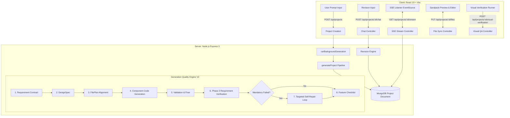
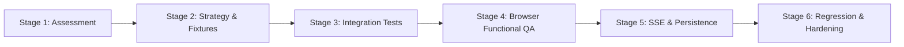

# Builder AI — Phase 5 System Assessment & Integration Architecture Report
**Document Version:** 1.0.0  
**Status:** Read-Only Assessment Complete (Stage 1)  
**Author:** Senior AI Systems Architect, Staff Full-Stack Engineer & Lead QA Automation Engineer  
**Date:** November 6, 2026  

---

## 1. Executive Summary

Phases 1 through 4 have hardened the individual stages of Builder AI's Generation Quality Engine V2:
- **Phase 1:** Hardened deterministic generation, AST transforms, mock isolation, and client linting.
- **Phase 2:** Established the Structured Requirement Contract schema, file plan alignment, and revision ordering.
- **Phase 3:** Built evidence-based requirement verification with static AST analysis across 4 verification layers.
- **Phase 4:** Implemented the targeted self-repair loop with 7 acceptance gates, regression rollback, and failure signature deduplication.

The system currently has **359 passing server unit and functional tests across 121 suites**, **clean client linting (0 warnings, 0 errors)**, and a **successful production client build (513ms)**.

The objective of **Phase 5** is **Full System Integration & End-to-End Hardening**. Rather than introducing new standalone modules, Phase 5 verifies that the entire stack—from user prompt input, multi-phase background generation, SSE streaming, Sandpack browser preview, multi-turn revisions, and visual responsive QA—behaves reliably as an integrated product under real-world conditions.

---

## 2. End-to-End System Architecture

---

## 3. Pipeline Lifecycle & Subsystem Analysis

### 3.1 Initial Generation Flow
1. **Entry Point:** `POST /api/projects` in [`server/controllers/projectController.js`](file:///Users/azmilmohammed/Desktop/builder-ai/server/controllers/projectController.js#L130). Validates user authentication, creates a `Project` document in MongoDB with `status: "pending"`, and responds with `{ _id }`.
2. **Asynchronous Execution:** Launches `runBackgroundGeneration(projectId, prompt)` in the background without blocking the HTTP response.
3. **Pipeline Stages:**
   - **Contract Formation:** [`generateRequirementContract`](file:///Users/azmilmohammed/Desktop/builder-ai/server/services/requirementContract.js) parses the prompt into structured intent (`RequirementContractSchema`). Emits `requirement_contract`.
   - **Design Intelligence:** [`generateDesignSpec`](file:///Users/azmilmohammed/Desktop/builder-ai/server/services/ai.js) applies Craftwork design archetype, color tokens, and typography. Emits `design_spec`.
   - **File Planning:** [`generateFilePlan`](file:///Users/azmilmohammed/Desktop/builder-ai/server/services/ai.js) establishes the component hierarchy. [`verifyFilePlanAlignment`](file:///Users/azmilmohammed/Desktop/builder-ai/server/services/requirementContract.js) validates mapping. Emits `plan`.
   - **Code Synthesis:** Generates `/styles.css` and planned components iteratively, emitting `file_start` and `file_complete`.
   - **Validation & Fixing:** Runs [`validateProject`](file:///Users/azmilmohammed/Desktop/builder-ai/server/services/codeValidator.js) and [`repairProjectFiles`](file:///Users/azmilmohammed/Desktop/builder-ai/server/services/ai.js). Emits `validating` and `repairing`.
   - **Requirement Verification:** [`verifyProjectRequirements`](file:///Users/azmilmohammed/Desktop/builder-ai/server/services/requirementVerification.js) tests code against contract across 4 evidence layers (Components, Functional AST, Design/Responsive, File Consistency). Emits `requirement_verification`.
   - **Targeted Self-Repair:** If mandatory failures exist, [`runEvidenceDrivenSelfRepairLoop`](file:///Users/azmilmohammed/Desktop/builder-ai/server/services/selfRepair.js) runs up to 2 attempts, isolating failures to target files, verifying candidates across 7 gates, and emitting granular self-repair events.
4. **Persistence & Handoff:** Saves `files`, `requirementContract`, `requirementVerification`, and `selfRepair` report to MongoDB. Sets `status: "visual_verifying"` and emits `visual_verifying`.

### 3.2 Visual QA & Completion Handoff
1. The client's [`AgentProgressDashboard`](file:///Users/azmilmohammed/Desktop/builder-ai/client/src/components/AgentProgressDashboard.jsx) activates [`VisualVerificationRunner`](file:///Users/azmilmohammed/Desktop/builder-ai/client/src/components/VisualVerificationRunner.jsx).
2. An offscreen Sandpack container renders the app at desktop (1440×900) and mobile (375×812) viewports. An injected observer script posts metrics (`scrollWidth`, `clientWidth`, errors) back to the parent window.
3. Client posts results to `POST /api/projects/:id/visual-verification`.
4. If defects exist, server runs 1 targeted visual fix (`performTargetedVisualRepair`). On verification pass or retry limit, sets `status: "completed"`, emits `completed`, and Sandpack preview renders.

### 3.3 Revision Workflow
1. User submits instruction in `ChatPanel` -> `POST /api/projects/:id/chat`.
2. Handled synchronously by `chat()` in [`server/controllers/chatController.js`](file:///Users/azmilmohammed/Desktop/builder-ai/server/controllers/chatController.js#L20).
3. **Ordering Hardening:** Candidate contract is pre-calculated via [`updateRequirementContractOnRevision`](file:///Users/azmilmohammed/Desktop/builder-ai/server/services/requirementContract.js#L812) before calling [`reviseProject`](file:///Users/azmilmohammed/Desktop/builder-ai/server/services/ai.js#L509).
4. [`applyOperations`](file:///Users/azmilmohammed/Desktop/builder-ai/server/services/diff.js) executes search/replace or full-content replacements. If search fails, regeneration fallback recovers the file.
5. If syntax or runtime errors occur, 1 targeted repair is executed via `repairProjectFiles`.
6. Candidate files are verified against the candidate contract via `verifyProjectRequirements`. If mandatory requirements fail, `runEvidenceDrivenSelfRepairLoop` is triggered.
7. If revision succeeds: updates `project.files`, increments `project.version += 1`, updates contract and verification, and saves to MongoDB.
8. If revision fails: preserves existing files, does not increment version, sets status to `completed`, and returns HTTP 422.

### 3.4 SSE Streaming & State Recovery
1. Client connects via `GET /api/projects/:id/stream`.
2. First event is `initial_state`, delivering the current database snapshot. If the project is already terminal (`completed` or `failed`), the stream terminates cleanly.
3. Client context ([`client/src/context/AppContext.jsx`](file:///Users/azmilmohammed/Desktop/builder-ai/client/src/context/AppContext.jsx#L128-L418)) handles 14 events.
4. **Resilience Fallback:** If SSE connection errors or drops, `startFallbackPolling` polls `GET /api/projects/:id` every 3 seconds until terminal status is reached.

---

## 4. Current Test Coverage Analysis

| Test Suite File | Test Count | Focus Area |
| :--- | :---: | :--- |
| `server/test/self_repair.test.js` | 15 | Targeted repair loop, 7 acceptance gates, regression rollback, signature deduplication |
| `server/test/requirement_verification.test.js` | 32 | Phase 3 AST evidence extraction, event handlers, state hooks, search filtering, carts |
| `server/test/requirement_contract.test.js` | 29 | Phase 2 contract generation, file plan alignment, revision updating, fallback contracts |
| `server/test/visual_verification_loop.test.js` | 25 | Viewport measurement, overflow detection, visual repair, API endpoint security |
| `server/test/dark_mode_revision_resilience.test.js` | 11 | Theme defaults, AST prop contracts, diff search/replace, chat failure rollback |
| `server/test/dependency_resolution.test.js` | 31 | Sandpack package preflight, npm validation, version pinning, package.json synthesis |
| `server/test/ecommerce_regression.test.js` | 18 | Storefront generation, cart state, total math, category filtering |
| `server/test/craftwork_integration.test.js` | 14 | Craftwork runtime guidance, prompt injection across pipeline stages, provider parity |
| `server/test/gemini_provider.test.js` | 8 | Gemini 2.5/3.5 SDK structured generation, error handling, rate limiting |
| `server/test/prop_contract_runtime.test.js` | 12 | Inter-component prop passing, undefined handler defaults, arrow function bindings |
| Legacy test suites (`phase1a` - `phase5a`) | ~164 | Historical unit tests for compiler, controllers, auth, and database |
| **Total Test Count** | **359** | **All passing, 0 failures, 0 regressions** |

---

## 5. Identified Integration Gaps & Critical Risks

Despite comprehensive unit test coverage, four critical integration gaps exist:

### Gap 1: Multi-Turn Revision Integrity (High Risk)
- **Problem:** Unit tests verify single revision turns in isolation. In actual usage, users submit 3, 4, or 5 consecutive revisions (e.g. Turn 1: create portfolio → Turn 2: change theme & hero → Turn 3: add projects search → Turn 4: redesign contact → Turn 5: remove navbar).
- **Risk:** Without a multi-turn integration test, contract drift can occur: previous turns' mandatory requirements could be dropped from `project.requirementContract`, version numbering could become inconsistent, or search/cart states could be broken by subsequent edits.

### Gap 2: Clean Generation Bypass Proof (Medium Risk)
- **Problem:** `selfRepair.js` has logic to exit immediately (`repairTriggered: false`) when initial verification passes.
- **Risk:** We must prove through an end-to-end integration test that clean code generation never incurs extra AI latency, never triggers unnecessary repair SSE events, and never updates MongoDB with false repair attempts.

### Gap 3: Real Browser Interactive Execution (High Risk)
- **Problem:** AST analysis checks code structure (e.g. `query` state exists, `filter` method exists). Virtual runtime smoke check verifies that `<App />` mounts in Node.js VM without throwing. Neither simulates an actual user typing into a search input, clicking a category filter, submitting a form, or opening a mobile navigation drawer.
- **Risk:** A component could have correct AST signatures but fail interactive behavior in a real browser (e.g. `preventDefault()` not called, event bubbling closing a drawer immediately, or CSS `pointer-events: none` blocking clicks).

### Gap 4: SSE Disconnection & Reconnection State Recovery (Medium Risk)
- **Problem:** When a user refreshes their browser mid-generation (e.g. during `validating` or `repairing`), the client reconnects via SSE.
- **Risk:** If `initial_state` or polling fallback does not rehydrate `selfRepair`, `visualVerification`, and `requirementVerification` properly, the UI can become stuck in a loading skeleton or display stale state.

---

## 6. Proposed Phase 5 Implementation Plan

Work will execute in strict adherence to the **6 controlled stages**:

### Stage 1: Read-Only Assessment & Architecture Report (Current)
- Complete `PHASE_5_SYSTEM_ASSESSMENT.md`.
- Inspect all files, controllers, client context, and existing test runners.
- Establish baseline verification and freeze source modifications until review.

### Stage 2: Test Strategy & Deterministic Fixtures
- Build deterministic multi-turn revision fixtures.
- Build clean generation fixtures with passing AST & responsive standards.
- Build interactive component test fixtures (Search, Forms, Tabs, Cart, Nav Drawer).
- Define reusable mock harnesses using `setAiGeneratorOverride`.

### Stage 3: End-to-End Generation & Revision Integration Suite
- Create `server/test/e2e_generation_pipeline.test.js`:
  - Scenario A: Realistic full pipeline generation with contract, file plan, validation, verification, and persistence.
  - Scenario B: Clean generation zero-repair bypass.
  - Scenario C: Resilient failure handling (provider timeout, invalid JSON, validation abort).
- Create `server/test/e2e_revision_lifecycle.test.js`:
  - 5-turn consecutive revision lifecycle testing theme change, search addition, contact redesign, conflicting removal, and contract continuity.

### Stage 4: Real Browser Functional & Responsive QA
- Utilize the existing headless Chrome execution harness pioneered in `server/test/browser_acceptance.js`.
- Package standalone preview bundles via Vite.
- Test interactive user flows:
  - Navigation: desktop link scrolling and mobile drawer open/close.
  - Search: query typing, dynamic list filtering, and clearing.
  - Forms: field entry, required validation, submission state, feedback message.
  - Interactive controls: tabs switching active content, modals.
- Measure visual layouts across 3 viewports: Desktop (1440×900), Tablet (768×1024), Mobile (375×812) verifying `scrollWidth <= clientWidth` (0px horizontal overflow).

### Stage 5: SSE Disconnection, Reconnection & Persistence Hardening
- Create `server/test/e2e_sse_persistence.test.js`:
  - Mid-generation SSE disconnect and client reconnection via `initial_state`.
  - Fallback polling recovery when SSE fails.
  - Out-of-order and duplicate event deduplication.
  - Database persistence consistency across project versions.

### Stage 6: Integrated Regression Suite, Defect Remediation & Final Reports
- Verify interaction between Phases 1–4 under hostile conditions.
- Implement any minimal, surgical bug fixes identified during Stages 2–5.
- Run complete test suites (`npm --prefix server test`, `npm --prefix client run lint`, `npm --prefix client run build`).
- Produce `PHASE_5_IMPLEMENTATION_REPORT.md` and `PHASE_5_TEST_REPORT.md`.

---

## 7. File Classification Matrix

### Files That May Require Targeted Hardening (Only if defects are discovered):
1. `server/controllers/chatController.js` — Ensure multi-turn revision contract merging cleanly preserves older mandatory requirements across 3+ consecutive revisions.
2. `server/controllers/projectController.js` — Verify `initial_state` delivers comprehensive `selfRepair` and `visualVerification` snapshots on reconnect.
3. `server/services/selfRepair.js` — Confirm retry limit logging and signature deduplication across multi-turn revisions.
4. `client/src/context/AppContext.jsx` — Ensure SSE reconnect handler never displays stale status or overwrites newer project files.
5. `client/src/components/AgentProgressDashboard.jsx` — Ensure all status transitions (generating, validating, repairing, visual_verifying, completed) display clearly.

### Files That Must Remain Untouched:
1. `server/services/aiSchemas.js` — Stable Zod contracts established in Phases 2–4.
2. `server/models/Project.js` — Schema contains all necessary fields (`requirementContract`, `requirementVerification`, `selfRepair`, `visualVerification`).
3. `server/services/prompts.js` — Craftwork design system and code generation prompts are verified and locked.
4. `server/services/diff.js` — Search/replace and full-content replacement algorithms are stable.
5. `server/services/codeValidator.js` — AST validation, runtime smoke check, and fixer routines are green.
6. `server/test/*.test.js` (Phases 1–4 existing suites) — Preserved without weakening any assertions.

---

## 8. Verification & Read-Only Status

- **Source Code Status:** Strictly untouched during Stage 1.
- **Git Branch:** `engine` (clean working tree with Phase 4 completed).
- **Test Baseline:** 359 server tests passing, 0 client lint errors, production build verified.

*Stage 1 is complete. Ready for Stage 2 (Test Strategy & Fixture Design) upon review and authorization.*

