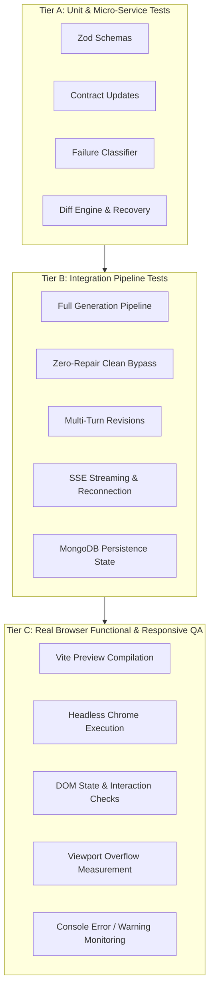
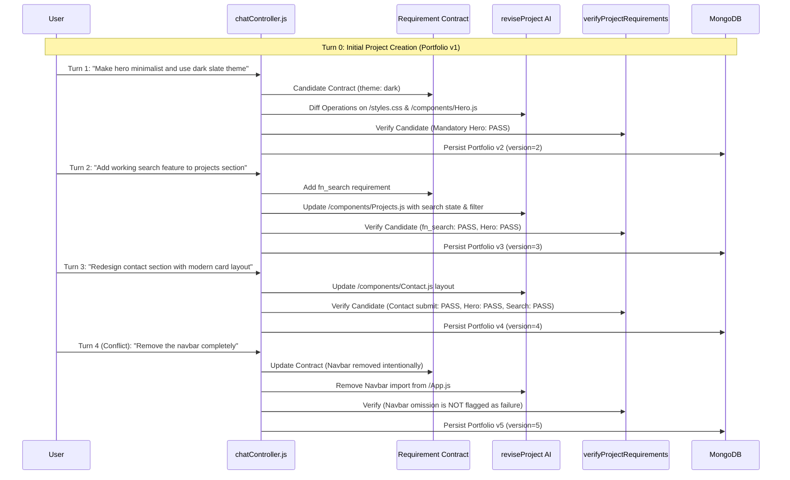
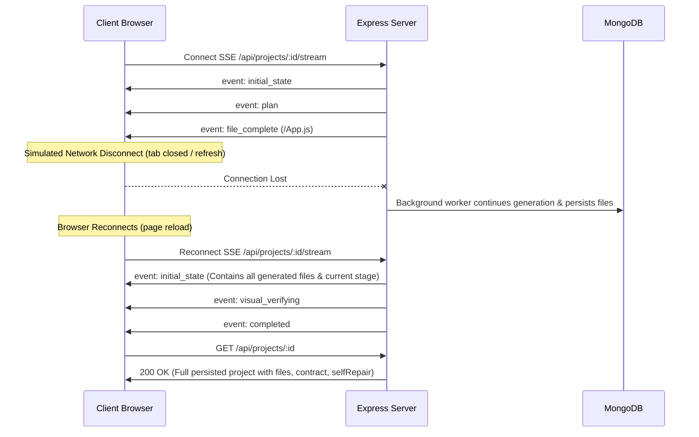

# Builder AI — Phase 5 Test Strategy & Test Fixture Design
**Document Version:** 1.0.0  
**Phase:** Phase 5 Stage 2 (Test Strategy & Test Fixture Design)  
**Author:** Senior QA Architect & Staff Software Test Engineer  
**Date:** November 6, 2026  

---

## 1. Existing Test Infrastructure & Reuse Analysis

The Builder AI repository currently contains **359 passing server tests across 121 suites** (`npm --prefix server test`), oxlint rules on client (`npm --prefix client run lint` with 0 warnings/errors), and a fast production Vite client build (`npm --prefix client run build`).

### 1.1 Existing Test Assets & Reusability Matrix

| Existing Test Asset | Existing Scope | Reusability in Phase 5 | Reason / Extension Plan |
| :--- | :--- | :---: | :--- |
| `server/test/self_repair.test.js` | 15 unit/functional scenarios on repair loop gates and classification | **Direct Reuse** | Preserves core Phase 4 regression coverage; will be referenced by Phase 5 regression tests. |
| `server/test/requirement_verification.test.js` | 32 AST analysis and layer verification tests | **Direct Reuse** | Verifies static extraction rules (state, handlers, props, responsive tokens). |
| `server/test/requirement_contract.test.js` | 29 contract generation and revision ordering tests | **Direct Reuse** | Verifies candidate contract updates and FilePlan alignment. |
| `server/test/visual_verification_loop.test.js` | 25 viewport measurement and visual fix tests | **Direct Reuse** | Verifies offscreen Sandpack metric extraction and server endpoint security. |
| `server/test/dark_mode_revision_resilience.test.js` | 11 revision diff search/replace and rollback tests | **Direct Reuse** | Verifies file hash stability and rollback on failed revision patches. |
| `server/test/dependency_resolution.test.js` | 31 npm package preflight and version pinning tests | **Direct Reuse** | Verifies package.json synthesis for client Sandpack instances. |
| `server/test/ecommerce_regression.test.js` | 18 e-commerce generation and cart calculation tests | **Extend into Fixture 4** | Will serve as the foundation for the interactive cart application fixture. |
| `server/test/browser_acceptance.js` | Standalone script building Vite preview and capturing Chrome screenshots | **Primary Architecture Baseline for E2E** | Existing script uses headless Google Chrome (`/Applications/Google Chrome.app`) via Vite bundle compilation. We will adapt this into automated, assertion-driven browser tests. |

### 1.2 Tests That Will NOT Be Duplicated
- No duplicate tests for Zod schema validation (already thoroughly covered in `self_repair.test.js` and `requirement_contract.test.js`).
- No duplicate AST parser edge-case tests (already covered in `requirement_verification.test.js`).
- No duplicate Sandpack npm package validation tests (covered in `dependency_resolution.test.js`).

---

## 2. Test Architecture: Three-Tier Hierarchy

To achieve full verification without introducing unnecessary third-party dependencies, Phase 5 organizes testing into three distinct tiers:



### Framework Selection:
1. **Tier A & Tier B (Unit & Integration):** Uses Node.js native test runner (`node:test` + `node:assert/strict`). This matches existing repository patterns, executes in milliseconds, and requires zero external runners.
2. **Tier C (Browser End-to-End & Responsive QA):** Utilizes the proven headless Google Chrome automation architecture already present in `server/test/browser_acceptance.js`:
   - Compiles generated website files into a standalone bundle using the project's existing Vite and React plugins (`../../client/node_modules/vite`).
   - Launches headless Google Chrome (`/Applications/Google Chrome.app`) with isolated `--user-data-dir` profiles.
   - Evaluates observable browser interaction and viewport metrics (`scrollWidth <= clientWidth`) across 1440×900, 768×1024, and 375×812 viewports.

---

## 3. Reusable Deterministic Website Fixtures

Four comprehensive, deterministic website fixtures are designed to support reproducible automated testing across initial generation, multi-turn revisions, and browser rendering.

---

### Fixture 1: Modern Portfolio Storefront
- **Purpose:** Verifies clean portfolio presentation, anchor navigation, and responsive typography.
- **Category:** `portfolio`
- **Expected Files:**
  - `/package.json`: React 18 dependencies.
  - `/styles.css`: Tailwind root variables, light theme `#ffffff`, zinc colors, `overflow-x: hidden`.
  - `/App.js`: Root container, imports `Navbar`, `Hero`, `Projects`, `Skills`, `Contact`.
  - `/components/Navbar.js`: Responsive navigation, brand title, desktop links (`#projects`, `#skills`, `#contact`), mobile menu toggle button (`md:hidden`).
  - `/components/Hero.js`: Prominent headline, creative subtext, "View Work" primary CTA button.
  - `/components/Projects.js`: Responsive 2-column/3-column project showcase grid with tags.
  - `/components/Skills.js`: Skill badges and categorized expertise areas.
  - `/components/Contact.js`: Inquiry form with name/email/message inputs and submit feedback state.
- **Mandatory Requirements:**
  1. `section_hero`: Prominent Hero section with creative title and primary CTA button.
  2. `section_projects`: Structured projects showcase grid.
  3. `section_contact`: Contact section with inquiry form.
  4. `responsive_adaptation`: Responsive layout with breakpoint classes (`md:`, `lg:`) and mobile navigation adaptation (`md:hidden`, `hidden md:flex`).
- **Required Interactions:**
  - Clicking navigation anchor links scrolls to target sections.
  - Clicking mobile menu button toggles mobile navigation links.
  - Entering text into contact form and clicking submit displays success feedback.
- **Expected Responsive Behavior:**
  - Desktop (1440×900): Horizontal navbar with links, 3-column project grid, 0px overflow.
  - Tablet (768×1024): 2-column project grid, 0px overflow.
  - Mobile (375×812): Hamburger button visible, desktop links hidden, 1-column project list, 0px overflow.
- **Expected Verification Result:** `overallStatus: "VERIFIED"`, `mandatoryFailed: 0`.

---

### Fixture 2: SaaS Product Landing Page
- **Purpose:** Verifies conversion-oriented layouts, pricing cards, and interactive CTA flows.
- **Category:** `saas_landing`
- **Expected Files:**
  - `/package.json`: Dependencies (`react`, `react-dom`, `lucide-react`).
  - `/styles.css`: Dark/light mode variables, modern gradient backgrounds.
  - `/App.js`: Imports `Header`, `Hero`, `Features`, `Pricing`, `Footer`.
  - `/components/Header.js`: Logo, product links, "Get Started" CTA button.
  - `/components/Hero.js`: Value proposition headline, animated subheadline, email signup input.
  - `/components/Features.js`: 3-card benefit grid with Lucide icons (`Sparkles`, `Shield`, `Zap`).
  - `/components/Pricing.js`: Monthly/annual billing toggle with 3 pricing tiers.
  - `/components/Footer.js`: Social links, copyright, privacy policy anchors.
- **Mandatory Requirements:**
  1. `section_hero`: Value proposition hero with email capture.
  2. `section_features`: Feature presentation with iconography.
  3. `section_pricing`: Interactive pricing comparison cards with billing toggle.
  4. `design_color_theme`: Consistent design theme matching designSpec.
- **Required Interactions:**
  - Clicking monthly/annual toggle dynamically updates displayed card pricing values.
  - Entering email and clicking "Get Started" triggers validation feedback.
- **Expected Responsive Behavior:**
  - Desktop: 3-column pricing grid, inline header links, 0px overflow.
  - Tablet: 2+1 pricing card layout, 0px overflow.
  - Mobile: Stacked single-column pricing cards, responsive padding, 0px overflow.
- **Expected Verification Result:** `overallStatus: "VERIFIED"`, `mandatoryFailed: 0`.

---

### Fixture 3: Searchable Dataset Directory
- **Purpose:** Verifies reactive search state, query-to-filter binding, empty states, and dynamic list rendering.
- **Category:** `interactive_app`
- **Expected Files:**
  - `/package.json`: React dependencies.
  - `/styles.css`: Clean directory styling with card hover transitions.
  - `/App.js`: Root directory state (`query`, `category`, `items`), imports `SearchBar`, `FilterTabs`, `DirectoryGrid`.
  - `/components/SearchBar.js`: Controlled search input (`value={query}`, `onChange={e => setQuery(e.target.value)}`), clear button (`onClick={() => setQuery('')}`).
  - `/components/FilterTabs.js`: Category filter pills (`All`, `Design`, `Engineering`, `Marketing`).
  - `/components/DirectoryGrid.js`: Renders filtered list `items.filter(...)`; displays dedicated empty state when 0 results match.
- **Mandatory Requirements:**
  1. `fn_search_filtering`: Controlled search input dynamically filtering visible directory items.
  2. `fn_category_tabs`: Category selection updating active directory view.
  3. `ui_empty_state`: Graceful empty state card when query yields 0 matching items.
- **Required Interactions:**
  - Typing "Engineer" filters grid items to only engineering roles.
  - Typing a non-matching query (e.g. "xyz123") hides all items and displays "No results found".
  - Clicking the "Clear" button resets input and restores all items.
  - Clicking category tab filters items by category.
- **Expected Responsive Behavior:**
  - Desktop: Search bar with category chips inline, 3-column cards.
  - Mobile: Full-width search bar, horizontally scrolling category chips, stacked cards, 0px overflow.
- **Expected Verification Result:** `overallStatus: "VERIFIED"`, `mandatoryFailed: 0`.

---

### Fixture 4: Interactive E-Commerce Application with Cart
- **Purpose:** Verifies multi-step interactive state, cart operations, quantity adjustments, and math calculations.
- **Category:** `ecommerce`
- **Expected Files:**
  - `/package.json`: React and Lucide icons.
  - `/styles.css`: E-commerce boutique styling, drawer animations.
  - `/App.js`: Root cart state (`cart`, `setCart`, `isCartOpen`), imports `Navbar`, `ProductGrid`, `CartDrawer`.
  - `/components/Navbar.js`: Brand title, cart trigger button with reactive item badge (`cart.reduce(...)`).
  - `/components/ProductGrid.js`: Product catalog with "Add to Bag" buttons calling `addToCart(product)`.
  - `/components/CartDrawer.js`: Slide-over cart drawer, item list, quantity `+` / `-` buttons, remove buttons, subtotal calculation (`reduce`), and checkout button.
- **Mandatory Requirements:**
  1. `fn_cart_state`: Reactive cart state management with add, update quantity, and remove operations.
  2. `fn_cart_math`: Accurate subtotal and total calculations derived from item prices and quantities.
  3. `ui_cart_drawer`: Toggleable slide-out drawer presenting current cart contents.
- **Required Interactions:**
  - Clicking "Add to Bag" on a product increments the cart badge counter and adds product to cart.
  - Clicking cart icon opens `CartDrawer`.
  - Clicking `+` increments quantity and recalculates subtotal.
  - Clicking `-` decrements quantity; clicking remove removes item.
  - Subtotal reflects exact math: `item.price * item.quantity`.
- **Expected Responsive Behavior:**
  - Desktop: Full slide-out drawer (420px width), 4-column product grid.
  - Mobile: Full-screen mobile cart overlay, 1-column product grid, 0px overflow.
- **Expected Verification Result:** `overallStatus: "VERIFIED"`, `mandatoryFailed: 0`.

---

## 4. Initial Generation Test Scenarios

File: `server/test/e2e_generation_pipeline.test.js`

### Scenario 4.1: Successful End-to-End Generation Journey
- **Setup:** Mock `setAiGeneratorOverride` configured with sequential generation responses (Requirement Contract → DesignSpec → FilePlan → CSS → Components).
- **Action:** Call `generateProject(prompt, callbacks)` with full progress callback tracking.
- **Expected Results:**
  - Execution order strictly follows: `onRequirementContract` → `onDesignSpec` → `onPlan` → `onFileStart` → `onFileComplete` (styles) → `onFileStart` (components) → `onFileComplete` → `validating` → `onRequirementVerification`.
  - Result object contains non-empty `files`, `designSpec`, `requirementContract`, `requirementVerification`, `manifest`, and `featureReport`.
  - `requirementVerification.overallStatus === "VERIFIED"`.
- **Assertions:** Check callback call sequence, verify all planned files exist in result, verify zero syntax/validation errors.

### Scenario 4.2: Clean Generation Zero-Repair Bypass
- **Setup:** Generation mock returns code matching Fixture 1, pre-verified to pass all mandatory requirements.
- **Action:** Run generation pipeline with self-repair callbacks hooked.
- **Expected Results:**
  - `result.selfRepair.repairTriggered === false`.
  - `result.selfRepair.attemptCount === 0`.
  - Zero `repair_started` or `repair_attempt_started` callbacks fire.
  - Generation completes without any secondary repair AI calls.
- **Assertions:** Verify zero repair invocations, verify `repairTriggered === false`.

### Scenario 4.3: Generation Failure Recovery
- **Sub-scenarios:**
  - **A. AI Provider Timeout / Network Crash:** Model throws rate limit or timeout error. Pipeline throws clean descriptive error without corrupting state.
  - **B. Invalid Structured Output:** AI returns invalid JSON schema. Caught by retry loop or fails gracefully with informative message.
  - **C. Code Validation Failure with Unrecoverable Syntax:** Model returns code that cannot be repaired. Resulting project reports `status: "failed"` with clear error details.
  - **D. Database Persistence Interruption:** Project document update failure handled safely without hanging background worker.
- **Assertions:** Incomplete projects are never marked `completed`; errors are clearly logged and sanitized.

---

## 5. Multi-Turn Revision Test Scenarios

File: `server/test/e2e_revision_lifecycle.test.js`

### Multi-Turn Consecutive Lifecycle (5 Turns on One Project)



#### Turn 1: Design & Theme Revision
- **Prompt:** `"Change the primary theme to dark slate and make the hero section minimalist."`
- **Checks:** Version increments to 2. `/styles.css` updates background to `#09090b`. Hero section simplifies. Projects, Skills, and Contact remain functional and unchanged.

#### Turn 2: Feature Addition (Search)
- **Prompt:** `"Add a working search feature to filter projects by keyword."`
- **Checks:** Version increments to 3. `/components/Projects.js` gains search input and reactive `.filter()`. Turn 1 dark theme and hero remain intact. Mandatory Hero and Contact requirements continue to PASS.

#### Turn 3: Component Redesign with Functionality Preservation
- **Prompt:** `"Redesign the contact section into a modern centered card layout."`
- **Checks:** Version increments to 4. `/components/Contact.js` layout is updated. Form fields, input state, and submit feedback handler are strictly preserved.

#### Turn 4: Conflicting User Revision (Intentional Feature Removal)
- **Prompt:** `"Remove the top navigation bar completely."`
- **Checks:** Version increments to 5. `/App.js` removes `<Navbar />`. Contract reflects user intent. `verifyProjectRequirements` does NOT flag the missing Navbar as a failure. All remaining mandatory requirements remain passing.

---

## 6. Real Browser Functional Test Scenarios

File: `server/test/e2e_browser_functional.test.js`

### Observable Interaction Checks (Executed in Real Headless Chrome)

| Component Area | Interaction Step | Observable Browser Assertion |
| :--- | :--- | :--- |
| **Navigation** | Click desktop anchor link `#projects` | Window `scrollY` changes to match `offsetTop` of `#projects`. |
| **Mobile Navigation** | Click hamburger button on mobile viewport | Mobile menu drawer changes from `display: none` / `opacity-0` to visible; navigation links become clickable. |
| **Search (Filtering)** | Type `"Design"` into directory search input | Non-matching card elements are removed from DOM; visible card count matches expected filtered count. |
| **Search (Empty State)** | Type `"XYZ_NON_EXISTENT_QUERY"` into search | Grid cards count becomes 0; DOM contains visible text "No results found" or empty state card. |
| **Search (Reset)** | Click search "Clear" icon / button | Search input value resets to `""`; full card list is restored in the DOM. |
| **Form (Validation)** | Click "Submit" on empty contact form | Browser HTML5 validation or custom state blocks submit; required inputs trigger `:invalid` state. |
| **Form (Feedback)** | Fill inputs with valid text and click "Submit" | Form triggers submit handler; DOM displays success message (e.g. "Message sent successfully!"). |
| **Interactive Tabs** | Click "Pricing Annual" tab button | Displayed pricing values change from `$29` to `$290`; active tab button receives active CSS class. |
| **Cart Controls** | Click "Add to Bag" on product card | Cart counter badge increments from 0 to 1; item appears in drawer DOM with correct title and price. |
| **Cart Math** | Click `+` quantity button inside cart | Quantity changes from 1 to 2; displayed subtotal recalculates to `price * 2`. |

---

## 7. Responsive QA Specifications

File: `server/test/e2e_responsive_qa.test.js`

### Viewport Matrix

| Viewport Name | Target Dimensions | Primary Responsive Assertions |
| :--- | :---: | :--- |
| **Desktop** | 1440 × 900 | Horizontal navbar visible; multi-column grid (3–4 cols); `document.documentElement.scrollWidth <= 1440` (0px horizontal overflow). |
| **Tablet** | 768 × 1024 | 2-column layout; adaptive padding; navigation fits without line breaks; `scrollWidth <= 768` (0px horizontal overflow). |
| **Mobile** | 375 × 812 | Mobile hamburger button visible; single-column stacked cards; drawer toggles cleanly; `scrollWidth <= 375` (0px horizontal overflow). |

### Automated Failure Detection:
1. **Overflow Detection:** Asserts `doc.scrollWidth <= clientWidth`. Any horizontal overflow `> 0px` fails the test.
2. **Clipping & Overlap:** Scans bounding rects of major sections (`header`, `main`, `section`, `footer`) to ensure `top` values are strictly sequential (`section[i+1].top >= section[i].top`).
3. **Console Hygiene:** Captures browser console logs; zero unhandled React hydration or runtime exceptions permitted.

---

## 8. SSE Streaming & Persistence Scenarios

File: `server/test/e2e_sse_persistence.test.js`



### Scenarios to Verify:
1. **Normal Delivery:** Full event sequence delivered in order.
2. **Mid-Generation Disconnect & Recovery:** Simulates client closing connection during `validating`. Verifies server continues generation, persists files to MongoDB, and upon reconnect, `initial_state` delivers complete current state.
3. **Fallback Polling:** When EventSource is terminated, client fallback polling (`GET /api/projects/:id` every 3s) accurately detects `status: "completed"`.
4. **Duplicate Events:** Duplicate plan or file events do not corrupt client state.

---

## 9. Mocking & Test Isolation Strategy

1. **AI Provider Isolation:**
   - Uses existing `setAiGeneratorOverride` / `resetAiGeneratorOverride` in `server/services/ai.js`.
   - Never makes live Gemini or OpenRouter API calls in automated tests.
   - Deterministic fixtures return pre-verified AST and code structures.
2. **Database Isolation:**
   - Tests stub Mongoose model methods (`Project.findById`, `Project.findOne`, `Project.findByIdAndUpdate`, `Project.save`) using clean function closures restored in `afterEach()`.
   - Projects are created with unique test IDs (`507f1f77bcf86cd799439011`, etc.) to prevent cross-test state leakage.
3. **Browser Automation Isolation:**
   - Headless Google Chrome launches with temporary unique user data directories (`/tmp/chrome-profile-${Date.now()}`) and cleans up after test execution.
   - Vite builds temporary preview bundles in isolated directory paths.

---

## 10. Execution Order & Staging Protocol

```
Stage 1: System Assessment & Architecture Report (COMPLETE)
   ↓
Stage 2: Test Strategy & Test Fixture Design (CURRENT)
   ↓
Stage 3: Generation & Revision Integration Tests
   ├── e2e_generation_pipeline.test.js
   └── e2e_revision_lifecycle.test.js
   ↓
Stage 4: Real Browser Functional & Responsive QA
   ├── e2e_browser_functional.test.js
   └── e2e_responsive_qa.test.js
   ↓
Stage 5: SSE Streaming, Persistence & Failure Recovery
   └── e2e_sse_persistence.test.js
   ↓
Stage 6: Integrated Regression Suite, Defect Remediation & Final Reports
   ├── PHASE_5_IMPLEMENTATION_REPORT.md
   └── PHASE_5_TEST_REPORT.md
```

---

## 11. Expected Test Execution Commands

```bash
# Run all server tests (including existing 359 tests + new Phase 5 suites)
npm --prefix server test

# Run specific Phase 5 test suites
node --test server/test/e2e_generation_pipeline.test.js
node --test server/test/e2e_revision_lifecycle.test.js
node --test server/test/e2e_browser_functional.test.js
node --test server/test/e2e_responsive_qa.test.js
node --test server/test/e2e_sse_persistence.test.js

# Client quality verification
npm --prefix client run lint
npm --prefix client run build
```

---

## 12. Acceptance Criteria for Phase 5 Approval

1. **Generation:** Initial generation executes end-to-end; clean code bypasses self-repair with 0 extra AI calls.
2. **Revisions:** 5-turn consecutive revision lifecycle passes with strict contract continuity and version incrementing.
3. **Functional Browser QA:** Real headless Chrome proves navigation, search filtering, form validation feedback, and tab switching work interactively.
4. **Responsive QA:** Real headless Chrome proves 0px horizontal overflow across Desktop (1440×900), Tablet (768×1024), and Mobile (375×812).
5. **SSE & Persistence:** Mid-stream disconnects and reconnects rehydrate full project state without data loss.
6. **Zero Regressions:** All existing 359 server tests continue to pass; client lint and build remain green.

---

## 13. Mapping: Stage 1 Gaps to Stage 2 Test Strategy

| Stage 1 Gap Identified | Addressed in Phase 5 Strategy | Primary Test Suite File |
| :--- | :--- | :--- |
| **Multi-turn revision contract drift** | Section 5: 5-turn consecutive revision lifecycle | `server/test/e2e_revision_lifecycle.test.js` |
| **Clean generation self-repair bypass** | Section 4: Scenario 4.2 zero-repair bypass | `server/test/e2e_generation_pipeline.test.js` |
| **Lack of real browser click interaction** | Section 6: Headless Chrome observable interaction | `server/test/e2e_browser_functional.test.js` |
| **Responsive measurement across 3 viewports** | Section 7: Viewport overflow measurement | `server/test/e2e_responsive_qa.test.js` |
| **SSE disconnect and state rehydration** | Section 8: Disconnect & initial_state recovery | `server/test/e2e_sse_persistence.test.js` |

