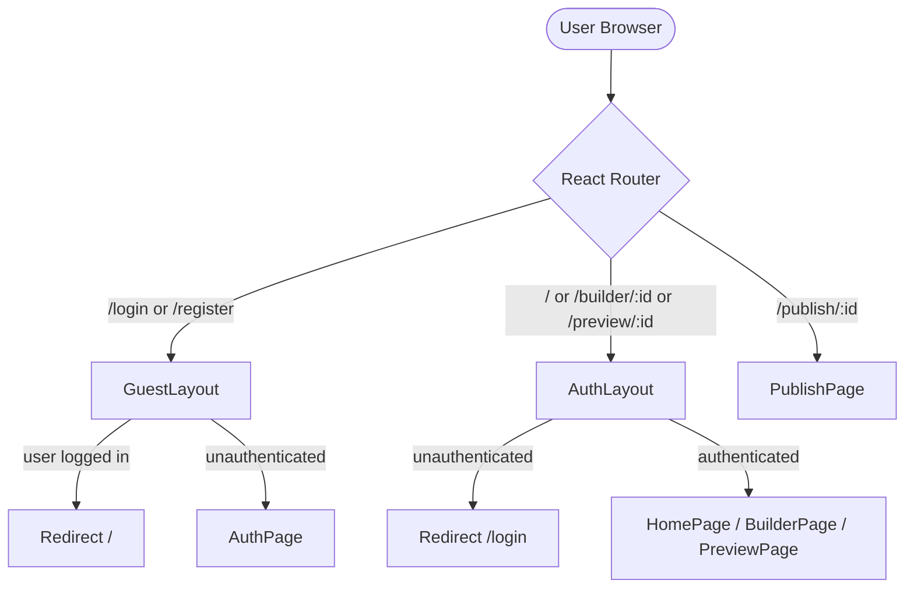
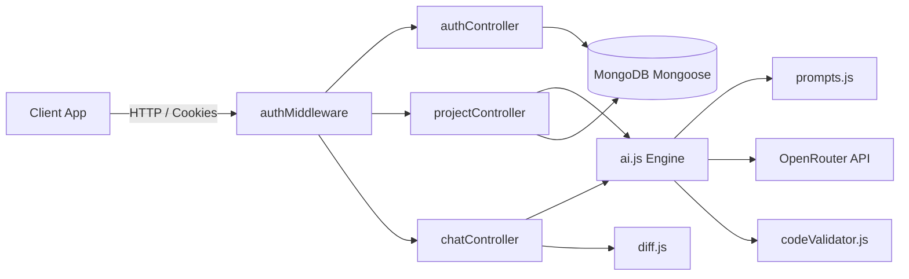
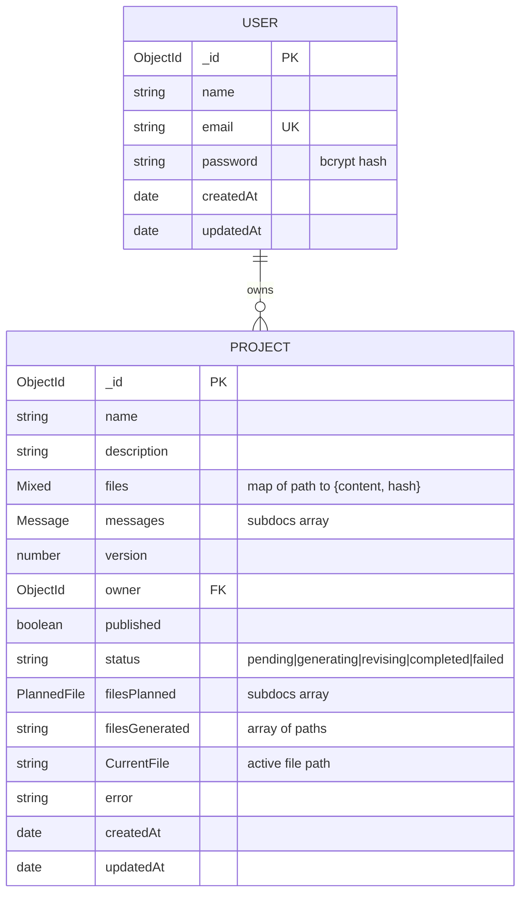
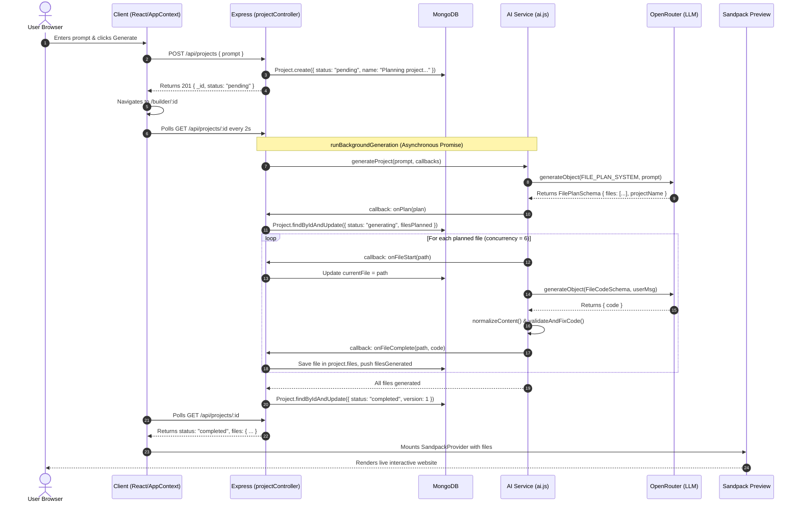
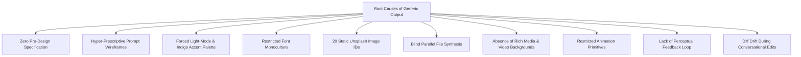
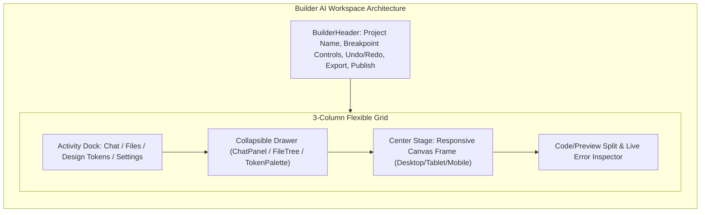
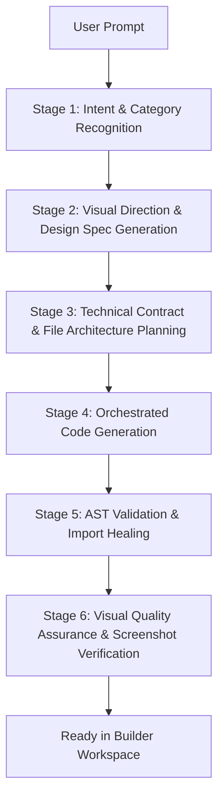
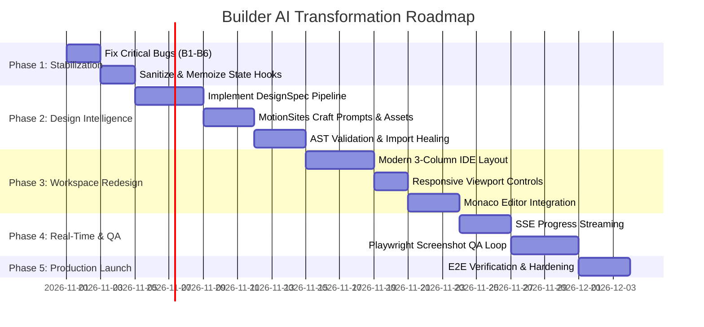

# Comprehensive Technical Architecture Audit & Transformation Blueprint
**Product:** Builder AI — AI-Powered React Website Builder  
**Author:** Principal Software Architect & Senior Full-Stack Engineer  
**Date:** October 31, 2026  
**Document Status:** Complete Architecture Audit (Pre-Implementation Baseline)  

---

## 1. Executive Summary

### 1.1 Project Context & Purpose
**Builder AI** is a full-stack, AI-powered web application that automates the generation, browser-based execution, live editing, and publishing of React websites from natural language prompts. Operating on a modern web stack—React 19, Vite, Tailwind CSS, and Sandpack on the frontend; Node.js, Express 5, and MongoDB on the backend; powered by OpenRouter and the AI SDK—the application aims to deliver an instantaneous, no-code to pro-code website creation workflow.

This architecture audit evaluates the entire existing system to prepare for a major product overhaul. The primary objective is to transition Builder AI from a basic, template-bound prototype into an agency-grade, production-quality AI website builder without unnecessarily discarding working infrastructure.

### 1.2 Summary of Current Architectural State
Builder AI possesses a functional end-to-end skeleton:
- **Client Application:** A single-page application built on React 19 and Vite, styled with Tailwind CSS, using React Router v7 for routing and Sandpack React for in-browser sandboxed code compilation and live previewing.
- **Backend API:** An Express 5 REST API using ES Modules, backed by MongoDB and Mongoose 9, utilizing HTTP-only cookie-based JWT sessions for user authentication.
- **AI Engine:** A two-phase generation pipeline using the Vercel AI SDK (`ai` v7) and `@ai-sdk/openai` pointed to the OpenRouter API. It plans a file tree via JSON schema generation, then generates files concurrently with `pMap` and applies post-generation regex corrections.
- **Revisions & Persistence:** Follow-up conversational prompts are handled through search-and-replace diff operations applied to the stored project file tree, with automatic debounced syncing from the Sandpack editor back to the database.

### 1.3 Key Strengths
1. **Sandboxed In-Browser Execution:** The integration of `@codesandbox/sandpack-react` enables immediate, client-side compilation and execution of React code without requiring remote container runtimes or cloud micro-VMs.
2. **Asynchronous Generation Flow:** Project creation immediately persists a record in MongoDB and runs AI generation as an un-awaited background process, preventing HTTP gateway timeouts during multi-file synthesis.
3. **Automated Post-Generation Code Repair:** The presence of `codeValidator.js` and `contentNormalizer.js` actively mitigates LLM syntax quirks (e.g., stripping markdown code fences, converting `class` to `className`, self-closing void JSX tags, fixing relative import paths).
4. **Targeted Diff Patching:** The chat revision system uses an operation-based manifest diff mechanism (`create`, `update`, `delete`) with whitespace-tolerant line matching to avoid regenerating entire projects for small edits.
5. **Client-Side Portability:** Projects can be exported directly from the browser as standard, runnable Vite/React ZIP archives.

### 1.4 Primary Architecture & Product Weaknesses
Despite its working foundation, the platform suffers from five severe categories of defects:

```
+---------------------------------------------------------------------------------------------------+
|                                 BUILDER AI — ROOT WEAKNESS TAXONOMY                               |
+---------------------------------------------------------------------------------------------------+
| 1. CRITICAL CODEBUGS (Silent Failures & Broken Flows)                                             |
|    - chatController.js: req.user.userId vs req.user.userID breaks all revision chats (404 Not Found)  |
|    - authRoutes.js: POST /api/auth/me vs AppContext.jsx GET /api/auth/me breaks session persistence |
|    - ai.js: ReferenceError on undefined 'file' variable in /App.js failure fallback path           |
|    - Project.js vs projectController.js: Schema casing mismatch (CurrentFile vs currentFile)       |
|    - AppContext.jsx: Unstable loadProject in polling useEffect creates infinite re-render loops    |
+---------------------------------------------------------------------------------------------------+
| 2. AI GENERATION STEREOTYPING (Generic Output & Design Stagnation)                                 |
|    - System prompt mandates Light Mode only; forbids dark mode unless explicitly asked           |
|    - Hardcoded single font stacks (Inter / DM Sans) with no typographic pairing archetypes        |
|    - Rigid SaaS layout prescription: Top chip, 100vh hero, 3-tier pricing with purple center,     |
|      floating card keyframe, Unsplash static ID list, and Font Awesome icon mandates              |
|    - Zero aesthetic planning phase: No design spec, color palette selection, or mood definition  |
+---------------------------------------------------------------------------------------------------+
| 3. SPARTAN & INCONSISTENT BUILDER UI/UX                                                           |
|    - Heavy background image on HomePage causing visual noise and poor legibility                  |
|    - Fixed 320px non-resizable sidebar; crude chat message string splitting hack ("- `/")         |
|    - No responsive preview controls (Desktop / Tablet / Mobile viewports)                        |
|    - No visual inspection, no file management (create/delete/rename in UI), no Monaco editor      |
+---------------------------------------------------------------------------------------------------+
| 4. CODE REPAIR & VALIDATION FRAGILITY                                                             |
|    - Regex-based code repair is fragile against complex JSX nesting and multi-line attributes     |
|    - Parallel file generation lacks coordination: components are generated blind to sibling code  |
|    - Runtime CDN dependencies inside Sandpack (Tailwind Play CDN, Font Awesome) create latency     |
+---------------------------------------------------------------------------------------------------+
| 5. LACK OF VISUAL EVALUATION & QUALITY GATES                                                      |
|    - The platform never visually inspects its output; no screenshot capture or perceptual scoring  |
|    - Follow-up chat revisions blind-patch code without checking whether styles remain coherent    |
+---------------------------------------------------------------------------------------------------+
```

---

## 2. Existing Technology Stack

### 2.1 Complete Stack Breakdown

| Layer | Technology | Version | Purpose & Architectural Role |
| :--- | :--- | :--- | :--- |
| **Frontend Framework** | React | `19.2.8` | Core UI component model and client state rendering |
| **Frontend Runtime** | React DOM | `19.2.8` | DOM mounting and client-side virtual DOM reconciliation |
| **Build Tooling** | Vite | `8.2.0` | Ultra-fast client dev server and production bundler |
| **Vite Plugins** | `@vitejs/plugin-react` | `6.0.4` | Fast Refresh and JSX transformation for React 19 |
| **CSS Framework** | Tailwind CSS | `4.3.3` | Utility-first styling framework |
| **Tailwind Vite Integration** | `@tailwindcss/vite` | `4.3.3` | Vite compiler plugin for Tailwind CSS v4 engine |
| **Routing** | React Router DOM | `7.18.2` | Client-side declarative routing and route guarding |
| **In-Browser Sandbox** | Sandpack React | `^2.20.0` | In-browser execution environment for generated React apps |
| **HTTP Client** | Axios | `^1.19.0` | Promise-based HTTP client configured with credentials |
| **Icons** | Lucide React | `^1.28.0` | Clean SVG iconography across the builder UI |
| **Notifications** | React Hot Toast | `^2.6.0` | Toast notifications for user feedback and error reporting |
| **Date Formatting** | Moment | `^2.30.1` | Relative time calculations (`moment().fromNow()`) |
| **Utilities** | Lodash.debounce | `^4.0.8` | Debouncing file saves to the backend |
| **Archive Utilities** | JSZip | `^3.10.1` | In-memory ZIP archive generation for project export |
| **File Download** | File-Saver | `^2.0.5` | Triggering browser downloads of generated ZIP files |
| **Linter** | Oxlint | `^1.75.0` | High-performance Rust-based JavaScript linter |
| **Backend Runtime** | Node.js | `>= 20.0.0` | Server runtime operating in ECMAScript Modules mode |
| **Backend Framework** | Express | `^5.2.1` | HTTP web application framework (Express v5) |
| **Database** | MongoDB | `>= 6.0` | Document-oriented NoSQL database for project & user state |
| **ODM** | Mongoose | `^9.10.0` | Schema-based object data modeling for MongoDB |
| **AI Integration** | AI SDK (`ai`) | `^7.0.143` | Structured object generation via `generateObject` |
| **AI Provider** | `@ai-sdk/openai` | `^4.0.96` | OpenAI-compatible adapter configured for OpenRouter |
| **Concurrency Utility** | `p-map` | `^7.1.1` | Concurrency-controlled promise mapping for file generation |
| **Schema Validation** | Zod | `^4.6.7` | Type-safe JSON schemas for structured AI output |
| **Authentication** | JSON Web Tokens (`jsonwebtoken`) | `^9.0.3` | Stateless signed session tokens for user authentication |
| **Password Hashing** | Bcrypt | `^6.0.0` | One-way cryptographic password salting and hashing |
| **Cookie Parsing** | Cookie-Parser | `^1.4.7` | Extracting session tokens from HTTP-only cookies |
| **CORS** | CORS | `^2.8.6` | Cross-Origin Resource Sharing middleware |
| **Environment** | Dotenv | `^17.4.2` | Loading environment variables from `.env` files |
| **Development Monitor**| Nodemon | `^3.1.14` | Auto-restarting server process during local development |

---

## 3. Actual Folder Structure

The project is structured as a decoupled two-tier monorepo without a package workspace manager:

```
builder-ai/
├── .agents/                                # Installed agent skills, workflows, and rules
│   ├── rules/                              # ECC engineering rules (react, web-design, security)
│   ├── skills/                             # ECC capability skills & Motionsites builder
│   │   └── motionsites-web-builder/        # Design references, media shelf, craft rules
│   └── workflows/                          # Standardized development workflows
├── client/                                 # Frontend SPA application
│   ├── public/                             # Static public assets
│   │   ├── bg-img.png                      # Full-bleed photographic background asset
│   │   ├── favicon.svg                     # Browser tab icon
│   │   └── logo.svg                        # Builder AI vector logo
│   ├── src/                                # React source code
│   │   ├── api/
│   │   │   └── api.js                      # Axios instance with baseURL and withCredentials
│   │   ├── assets/
│   │   │   └── assets.js                   # Static tag list for homepage marquee
│   │   ├── components/                     # Reusable React components
│   │   │   ├── AgentProgressDashboard.jsx  # File generation progress checklist & bar
│   │   │   ├── BuilderHeader.jsx           # Top action bar (Code/Preview toggle, Export, Publish)
│   │   │   ├── ChatPanel.jsx               # AI revision conversation stream and input
│   │   │   ├── FileExplorer.jsx            # Tree-view file navigator
│   │   │   ├── FullPagePreview.jsx         # Standalone full-viewport Sandpack preview
│   │   │   ├── Loading.jsx                 # Fullscreen spinner fallback
│   │   │   ├── LoginLeft.jsx               # Left branding banner for auth screens
│   │   │   ├── PreviewPanel.jsx            # Sandpack wrapper (Editor + Live Preview)
│   │   │   ├── Promptinput.jsx             # Textarea input with glass and default variants
│   │   │   ├── PublishModal.jsx            # Modal displaying published site URL
│   │   │   └── SandpackErrorMonitor.jsx    # Hook/component suppressing transient network errors
│   │   ├── context/
│   │   │   └── AppContext.jsx              # Global state provider (Auth, Projects, Polling)
│   │   ├── pages/                          # React Router page components
│   │   │   ├── AuthPage.jsx                # Unified Login and Registration page
│   │   │   ├── BuilderPage.jsx             # Main IDE workspace (Sidebar + Preview/Editor)
│   │   │   ├── HomePage.jsx                # Landing dashboard, project history, prompt hero
│   │   │   ├── Layout.jsx                  # Route guards (AuthLayout and GuestLayout)
│   │   │   ├── PreviewPage.jsx             # Dedicated authenticated fullscreen preview
│   │   │   └── PublishPage.jsx             # Public unauthenticated view of published projects
│   │   ├── utils/
│   │   │   ├── exportProject.js            # Client-side ZIP packager
│   │   │   └── sandpackUtils.js            # Regex-based AST dependency detector
│   │   ├── App.jsx                         # Main route declarations and Toaster integration
│   │   ├── index.css                       # Global styles, fonts, and Sandpack overrides
│   │   └── main.jsx                        # React 19 root entry with BrowserRouter & Context
│   ├── .oxlintrc.json                      # Oxlint linter configuration
│   ├── index.html                          # HTML shell
│   ├── package.json                        # Frontend dependencies and scripts
│   └── vite.config.js                      # Vite configuration with React and Tailwind plugins
├── server/                                 # Backend REST API
│   ├── config/
│   │   └── db.js                           # Mongoose connection logic
│   ├── controllers/
│   │   ├── authController.js               # Register, login, logout, me handlers
│   │   ├── chatController.js               # Project revision diff endpoint
│   │   └── projectController.js            # Project CRUD, publishing, and background worker
│   ├── middleware/
│   │   └── authMiddleware.js               # JWT verification from HTTP-only cookies
│   ├── models/
│   │   ├── Project.js                      # Project, Message, and PlannedFile Mongoose schemas
│   │   └── User.js                         # User account schema with bcrypt pre-save hook
│   ├── routes/
│   │   ├── authRoutes.js                   # /api/auth route definitions
│   │   └── projectRoutes.js                # /api/projects route definitions
│   ├── services/
│   │   ├── ai.js                           # OpenRouter AI SDK orchestration (Plan, Gen, Revise)
│   │   ├── aiSchemas.js                    # Zod schemas for structured AI generation
│   │   ├── codeValidator.js                # Post-gen syntax fixes and import path re-writing
│   │   ├── contentNormalizer.js            # String unescaping and BOM removal
│   │   ├── diff.js                         # Search/replace diff operations on file trees
│   │   └── prompts.js                      # System prompts (BASE_SYSTEM, FILE_PLAN, REVISE)
│   ├── .env                                # Server environment configuration
│   ├── package.json                        # Backend dependencies and scripts
│   └── server.js                           # Express app initialization, CORS, and port listening
├── docs/                                   # Documentation and architecture blueprints
├── .gitignore                              # Git exclusion rules
└── README.md                               # Project documentation and setup guide
```

---

## 4. Frontend Architecture

### 4.1 Entry Point and Application Bootstrapping
Application execution begins in `client/src/main.jsx`. React 19's `createRoot` mounts the root component inside `document.getElementById('root')`. The tree is wrapped in two top-level providers:
1. `BrowserRouter` (`react-router-dom` v7) providing client routing.
2. `AppContextProvider` (`client/src/context/AppContext.jsx`) managing global user authentication and active project state.

### 4.2 Routing Architecture and Layout Guards
Routing is declared centrally in `client/src/App.jsx`:
- **Guest Routes (`/login`, `/register`):** Protected by `GuestLayout` (`client/src/pages/Layout.jsx`). If a session cookie exists and `user` is populated, authenticated users are immediately redirected to `/`.
- **Protected Routes (`/`, `/builder/:id`, `/preview/:id`):** Protected by `AuthLayout`. If `loadingUser` is true, a full-screen `<Loading />` spinner renders. If `user` is null, unauthenticated visitors are redirected to `/login`.
- **Public Routes (`/publish/:id`):** Completely unauthenticated view (`PublishPage.jsx`) displaying published sites.
- **Catch-All Route (`*`):** Redirects undefined URLs back to `/`.



### 4.3 State Management & React Context
State is centralized in `client/src/context/AppContext.jsx` using React Context. It maintains:
- `user`, `loadingUser`: Authentication state.
- `projects`, `loadingProjects`: Dashboard project summaries.
- `activeProject`, `loadingActiveProject`: Full JSON model of the current project, including all file contents.
- `activeFile`: Path of the file currently selected for viewing/editing in the file explorer (`/App.js` by default).
- `showCode`: Boolean toggling between code editor and preview panel.
- `chatLoading`, `generatingProject`: Busy indicators for conversational revisions and initial builds.

#### Polling Mechanism
When an ongoing status (`pending`, `generating`, `revising`) is detected on `activeProject`, `AppContext.jsx` initiates an interval polling `GET /api/projects/:id` every 2000ms until the status transitions to `completed` or `failed`:
```javascript
// client/src/context/AppContext.jsx (Lines 126-140)
useEffect(() => {
    if (!activeProject?._id || !user) return;
    const isOngoing = activeProject.status === "generating" || 
                      activeProject.status === "pending" || 
                      activeProject.status === "revising";

    if (isOngoing) {
        setChatLoading(true);
        const interval = setInterval(() => {
            loadProject(activeProject._id, true); // silent refresh
        }, 2000);
        return () => clearInterval(interval);
    } else {
        setChatLoading(false);
    }
}, [activeProject?._id, activeProject?.status, loadProject, user]);
```

### 4.4 In-Browser Compilation: Sandpack Integration
Builder AI executes generated code entirely inside the browser using `@codesandbox/sandpack-react` v2.20.0 (`client/src/components/PreviewPanel.jsx` and `FullPagePreview.jsx`).
- **Template:** Set to `"react"`.
- **File Conversion:** The stored project files map (`{ "/App.js": "..." }`) is converted into Sandpack's required schema (`{ "/App.js": { code: "...", active: boolean } }`).
- **Dynamic Dependency Injection:** `detectDependencies` (`sandpackUtils.js`) parses import statements using regex (`/from\s+['"]([^./][^'"]*)['"]/g`) and dynamically injects detected npm packages with version `"latest"`.
- **Runtime Styling:** External resources load the runtime Tailwind Play CDN script (`https://cdn.tailwindcss.com`) and Font Awesome v6 CSS (`https://cdnjs.cloudflare.com/...`) directly into the Sandpack iframe.
- **Two-Way Code Sync:** `SandpackFileWatcher` detects code modifications in `SandpackCodeEditor`, updates local `liveFiles`, and fires a debounced (1000ms) HTTP `PUT /api/projects/:id/files` to persist user edits.

---

## 5. Backend Architecture

### 5.1 Server Lifecycle & Middleware Pipeline
The backend is initialized in `server/server.js`:
1. Database connection is awaited top-level via `await connectToDatabase()` (`server/config/db.js`).
2. CORS is configured with `credentials: true` and origins parsed from `process.env.ORIGINS.split(",")`.
3. Standard middleware: `cookie-parser` for session cookies, `express.json()` for request bodies.
4. Route mounting: `/api/auth` -> `authRouter`, `/api/projects` -> `projectRouter`.
5. Global Express error handler intercepting uncaught exceptions and returning HTTP 500 JSON.
6. HTTP server listens on `process.env.PORT || 3000`.

### 5.2 API Service Architecture & Controller Layer



#### Detailed Endpoint Inventory
- `POST /api/auth/register`: Creates a user with hashed password; signs a 30-day JWT; sets HTTP-only cookie.
- `POST /api/auth/login`: Verifies email and bcrypt password; sets session cookie.
- `POST /api/auth/logout`: Clears session cookie (`maxAge: 0`).
- `POST /api/auth/me`: Authenticated endpoint returning user profile. *(Note: Defined as POST in router, queried as GET by client!)*
- `POST /api/projects`: Initiates background generation; creates project in status `pending`; returns 201 immediately.
- `GET /api/projects`: Returns an array of project metadata (`_id`, `name`, `description`, `version`, timestamps) belonging to the authenticated user.
- `GET /api/projects/:id`: Returns full project model with all file contents flattened into `{ [path]: content }`.
- `DELETE /api/projects/:id`: Deletes project by ID and owner.
- `PUT /api/projects/:id/files`: Manually updates file contents and recomputes MD5 hashes.
- `POST /api/projects/:id/publish`: Marks project `published: true`.
- `GET /api/projects/public/:id`: Public endpoint returning files of published projects.
- `POST /api/projects/:id/chat`: Receives revision prompt; runs AI diff generation; applies operations; returns updated version.

---

## 6. Database Design

### 6.1 Mongoose Schemas & Relationships

The database is built on two collections in MongoDB: `users` and `projects`.



### 6.2 Schema Evaluation & Findings
1. **`files` Storage Model:** Stored as `Schema.Types.Mixed`:
   ```javascript
   files: {
     "/App.js": { content: "...", hash: "a3f1c8..." },
     "/styles.css": { content: "...", hash: "e9d2b1..." }
   }
   ```
   *Analysis:* Storing code files directly inside a single MongoDB document is fast for small web apps (typically < 100KB total), well below MongoDB's 16MB document limit. However, updating an individual file requires serializing and writing the entire document, which creates concurrency race conditions during parallel file generation.
2. **Casing Discrepancy on `CurrentFile`:**
   In `server/models/Project.js` line 26:
   ```javascript
   CurrentFile: {type: String, default: null},
   ```
   In `server/controllers/projectController.js` lines 37, 59, 96, 119, 211, it is queried and written as `currentFile` (lowercase `c`). Because Mongoose default schemas enforce strict casing, writes to `currentFile` are discarded or fail to map cleanly.

---

## 7. Authentication and Security Architecture

### 7.1 Session Security
- **Authentication Method:** JWT stored in an HTTP-only cookie named `token`.
- **Cookie Security Attributes:**
  - `httpOnly: true` (prevents JavaScript reading the token via `document.cookie`, mitigating XSS exfiltration).
  - `sameSite: "lax"` (mitigates CSRF for standard navigations).
  - `secure: process.env.NODE_ENV === "production"` (transmits cookies only over HTTPS in production).
  - `maxAge: 30 * 24 * 60 * 60 * 1000` (30-day session lifetime).

### 7.2 Identified Security Vulnerabilities

> [!CAUTION]
> **Vulnerability 1: Hardcoded JWT Fallback Secret**  
> In `server/middleware/authMiddleware.js` (line 11) and `server/controllers/authController.js` (line 4):
> ```javascript
> const JWT_SECRET = process.env.JWT_SECRET || "fallback_secret";
> ```
> If `JWT_SECRET` is unset in production, any attacker can forge arbitrary JWTs signed with `"fallback_secret"` to impersonate any user.

> [!WARNING]
> **Vulnerability 2: Missing Rate Limiting on AI & Auth Endpoints**  
> Neither Express route uses `express-rate-limit`. An attacker can brute-force passwords on `/api/auth/login` or spam `/api/projects` and `/api/projects/:id/chat`, exhausting OpenRouter API credits and saturating the database.

> [!WARNING]
> **Vulnerability 3: Public Project Enumeration**  
> `GET /api/projects/public/:id` takes raw 24-character hex MongoDB ObjectIds without access tokens, password protection, or unguessable slugs.

---

## 8. Complete AI Generation Lifecycle

The following sequence traces the exact end-to-end execution flow of project creation and code generation:



### Detailed Step-by-Step Lifecycle Description

1. **Prompt Submission:** The user types a prompt into `Promptinput.jsx` on `HomePage.jsx` and submits.
2. **Project Record Initialization:** `AppContext.handleGenerate` dispatches `POST /api/projects`. `projectController.createProject` inserts a new document in MongoDB with `status: "pending"` and returns the project ID to the client.
3. **Client Navigation & Polling:** The client redirects to `/builder/:id`. `AppContext` detects `status: "pending"` and fires a polling loop (`setInterval` every 2000ms) against `GET /api/projects/:id`.
4. **Phase 1 — AI File Planning:**
   - `runBackgroundGeneration` calls `generateProject(prompt)` in `server/services/ai.js`.
   - AI SDK calls OpenRouter using `generateObject` with `FilePlanSchema` and `FILE_PLAN_SYSTEM`.
   - The LLM returns a structured JSON list of files with their paths, descriptions, imports, and exports.
   - The engine automatically ensures `/App.js` and `/styles.css` exist in the plan.
   - The `onPlan` callback sets `status: "generating"` and records `filesPlanned` in MongoDB.
5. **Phase 2 — Concurrency-Controlled File Generation:**
   - Planned files are mapped through `pMap` with concurrency `MAX_CONCURRENCY = 6`.
   - For each file, `onFileStart` notifies the database.
   - `generateSingleFile` constructs the file prompt via `buildFileCodeSystem` and queries OpenRouter.
   - The returned code is processed by `normalizeContent` (removes escape sequences and BOMs) and `validateAndFixCode` (regex fixes for `class` -> `className`, self-closing void tags, default export guarantees, import path resolution).
   - `onFileComplete` saves the code and its MD5 hash into `project.files[path]`, appends `path` to `filesGenerated`, and saves the document.
6. **Completion & Polling Termination:**
   - Once all files are written, `project.status` is set to `"completed"`.
   - The frontend's next 2-second poll receives `status: "completed"` with the full file dictionary, halts the polling interval, and renders `PreviewPanel`.
7. **Sandpack Execution:** `PreviewPanel` feeds the file tree into Sandpack, dynamically resolves dependencies via `detectDependencies`, loads Tailwind Play CDN and Font Awesome, and displays the running site.
8. **Follow-Up Revision Loop:**
   - The user submits a change request in `ChatPanel`.
   - Client sends `POST /api/projects/:id/chat`.
   - `chatController.chat` passes a file manifest, relevant file contents, and recent chat history to `reviseProject`.
   - The LLM outputs an array of operations (`create`, `update`, `delete`).
   - `diff.applyOperations` applies search-and-replace updates with whitespace normalization.
   - Project version is incremented, updated files are saved, and the modified project is returned.

---

## 9. AI Prompt and Generation Analysis

### 9.1 Prompt Engineering Architecture in `server/services/prompts.js`
The prompts are divided into four main exports:
1. `BASE_SYSTEM`: The master behavioral persona, design rules, and technical constraints.
2. `FILE_PLAN_SYSTEM`: Instructions for determining the file architecture.
3. `REVISE_SYSTEM`: Rules for generating diff-based search/replace operations.
4. `buildFileCodeSystem`: Dynamic prompt builder injecting planned file lists and previously generated files.

### 9.2 Critical Prompt Limitations

#### 1. The Light-Mode Constraint (Lines 54-57)
```text
CRITICAL COLOR MODE RULE:
- ONLY CREATE PROJECTS IN LIGHT MODE BY DEFAULT. Do NOT use dark mode or dark background themes unless the user explicitly asks for dark mode/theme in their prompt.
- Use strictly ONE mode throughout the entire project — do NOT mix dark and light themes in the same website.
```
*Impact:* This forces nearly 100% of generated websites into an identical white/zinc-50 aesthetic. High-contrast dark themes, nocturnal styling, cinematic atmospheres, and moody luxury designs are forbidden by default.

#### 2. The Monoculture Typography Rule (Lines 36-41)
```text
- Font Stack: Import a premium font from Google Fonts. Use `Inter` for clean SaaS/tech, `Plus Jakarta Sans` for modern agency, or `DM Sans` for startup vibes.
```
*Impact:* Every generated site imports the same three standard sans-serif fonts. High-contrast display serifs, condensed gothic headers, mono technical accents, and expressive typographic pairings are completely absent.

#### 3. Hyper-Prescriptive Component Formulas (Lines 94-133)
```text
Hero Section (MUST BE SPECTACULAR)
- Top badge/chip: <span class='inline-flex items-center gap-1.5 px-3 py-1 rounded-full bg-indigo-50 text-indigo-700...'>
- Pricing Cards: Three tiers, center card highlighted with accent color background and a "Most Popular" badge: bg-indigo-600 text-white
- Testimonials: 2–3 column card grid
- Footer: Dark background (bg-zinc-950), light text
```
*Impact:* The AI does not design—it fills in blanks on a pre-determined wireframe. Every generated landing page contains the exact same sequence: sticky nav, chip badge, centered H1 with an indigo-to-violet gradient text span, floating card, 3-card bento grid, 3-tier pricing card with purple center, 3-column testimonial cards, dark CTA box, and black footer.

#### 4. Hardcoded Media Assets (Lines 184-194)
```text
Verified photo IDs by category:
- Developer/Tech: photo-1498050108023-c5249f4df085, photo-1486312338219-ce68d2c6f44d...
- Dashboard/SaaS: photo-1531403009284-440f080d1e12, photo-1607798748738-b15c40d33d57...
```
*Impact:* Only ~20 static Unsplash image IDs are provided across the entire application. The exact same developer looking at a laptop or the same office building appears in almost every project.

---

## 10. Reasons Behind Generic Website Generation

Our investigation reveals **ten concrete technical and prompt-level causes** for why Builder AI's generated websites lack distinct identity:



1. **Zero Pre-Design Planning Phase:**  
   The pipeline jumps directly from the user's prompt to a file plan (`/App.js`, `/components/Hero.js`). There is no intermediate step defining an aesthetic direction, mood keywords, color tokens, layout hierarchy, or signature visual moments.
2. **The "SaaS Template Trap" in System Prompts:**  
   `BASE_SYSTEM` hardcodes a specific wireframe (badge chip, H1, floating card, 3-tier pricing with purple center). Regardless of whether the user requests a bakery, medical clinic, or law firm, the LLM applies this tech-startup template.
3. **Color Monotony & Banned Dark Mode:**  
   Mandating light mode by default with white (`#ffffff`), zinc-100 surfaces, and indigo-600 accents prevents the visual variety found in modern web design (e.g., dark luxury, editorial paper tones, cybernetic neon, or earth minimalism).
4. **Typographic Conformity:**  
   The system never utilizes deliberate typography pairing archetypes (such as high-contrast editorial serifs like *Instrument Serif* paired with neutral grotesks, or condensed heavy headers with mono eyebrows). It relies exclusively on Inter or Plus Jakarta Sans.
5. **Static Asset Bottlenecks:**  
   Generated pages have no access to cinematic looping video backgrounds, transparent cut-out overlays, SVG noise/grain textures, or diverse photo libraries. They recycle the same 20 hardcoded Unsplash IDs.
6. **Blind Parallel Generation:**  
   Generating all components simultaneously with `pMap({ concurrency: 6 })` means `Header.js`, `Hero.js`, `Features.js`, and `Pricing.js` are created concurrently without seeing each other's output. Colors, container paddings, card borders, and button styles drift apart across components.
7. **Rudimentary CSS Keyframes:**  
   Animations are limited to three basic CSS keyframes (`float`, `fadeInUp`, `fadeIn`). There is no scroll-driven choreography, no staggered entrance sequencing, and no smooth micro-interaction framework (like Framer Motion).
8. **Font Awesome CDN Fallback:**  
   Instead of bespoke inline SVG icons tailored to the brand aesthetic, the prompt forces Font Awesome icons via CDN (`fa-solid fa-rocket`), which frequently fail to render if CDN links are blocked or delayed.
9. **Absence of Visual Quality Gates:**  
   The system never takes a screenshot or renders the page to evaluate its visual composition before delivering it to the user. Errors like overlapping text, clipped viewports, or unbalanced margins go completely undetected.
10. **Follow-Up Prompt Style Decay:**  
    When a user requests a change via chat, `REVISE_SYSTEM` performs isolated search-and-replace patches without re-evaluating the global design system, often introducing mismatched colors or broken layouts.

---

## 11. Existing UI/UX Evaluation

### 11.1 Comprehensive Surface-by-Surface Review

#### Dashboard & Home Surface (`client/src/pages/HomePage.jsx`)
- **Visuals:** Uses a heavy photographic background image (`bg-[url('/bg-img.png')]`) covering the entire viewport, creating visual clutter and reducing contrast behind text and input fields.
- **Header:** Basic brand mark with a bare "Sign out" text button.
- **Prompt Hero:** Includes an artificial "PROMO" pill badge that cannot be dismissed, paired with a generic tag marquee.
- **Project List:** Displays a simple vertical list of project cards. Lacks search, filtering, tags, project thumbnail previews, and grid view options.

#### Builder Workspace (`client/src/pages/BuilderPage.jsx`)
- **Workspace Layout:** A rigid two-column layout. The left sidebar is fixed at 320px with no drag-to-resize handle.
- **Navigation Header (`BuilderHeader.jsx`):** Displays basic metadata and action buttons (Code/Preview toggle, Open Preview, Publish, Export, Sign out). Lacks viewport breakpoint toggles (Desktop, Tablet, Mobile) and Zoom controls.
- **File Explorer (`FileExplorer.jsx`):** Displays a basic directory tree. Users cannot create new files, rename existing files, or delete files directly in the interface.
- **Code Editor (`SandpackCodeEditor`):** Embedded within Sandpack. Lacks multi-file tabs, file search/replace, syntax error linting panels, and the advanced capabilities of Monaco Editor.
- **Live Preview (`PreviewPanel.jsx`):** Fixed to a 100% iframe with no responsive container sizing. Users cannot test how generated sites behave on mobile screens without manually resizing their browser window.
- **Chat & Revision Panel (`ChatPanel.jsx`):** Employs a primitive string parsing hack:
  ```javascript
  // client/src/components/ChatPanel.jsx (Lines 39-44)
  {msg.content.split("- `/").map((text, i) => (
    <span key={i} className="block mt-3">
      <span className={i === 0 ? "hidden" : ""}>- `/</span>
      {text}
    </span>
  ))}
  ```
  Does not stream tokens in real-time, displays no visual diffs of modified code, and offers no rollbacks or version roll-back buttons.

#### Feedback & Empty States
- **Loading State:** A bare spinner (`Loading.jsx`). No skeleton screens or contextual loading indicators.
- **Error Handling:** Errors are displayed as simple `react-hot-toast` notifications. If generation fails, `AgentProgressDashboard` displays an error banner but offers no one-click retry, repair, or rollback actions.

---

## 12. Technical Debt and Weaknesses

The following verified defects were identified during file-by-file inspection:

### 12.1 Critical Implementation Bugs

| # | File & Location | Description of Defect | Operational Severity |
| :--- | :--- | :--- | :--- |
| **B1** | `server/controllers/chatController.js` (Line 30) | Queries `owner: req.user.userId` instead of `req.user.userID`. Because `authMiddleware` populates `req.user.userID` (capital ID), `req.user.userId` is `undefined`. MongoDB query fails to match, returning `404 Project not found`. **Conversational revisions are completely broken.** | **CRITICAL** |
| **B2** | `server/routes/authRoutes.js` (Line 10) vs `client/src/context/AppContext.jsx` (Line 29) | Route defines `authRouter.post('/me', ...)`, but client invokes `api.get('/api/auth/me')`. Express returns `404 Cannot GET /api/auth/me`, causing `AppContext` to clear session and log out users on page refresh. | **CRITICAL** |
| **B3** | `server/services/ai.js` (Lines 144-150) | In the fallback placeholder creation for `/App.js`, references undefined variable `file` (`const ext = file.path.split('.').pop()`). Throws an uncaught `ReferenceError: file is not defined`, crashing the generation worker. | **HIGH** |
| **B4** | `server/models/Project.js` (Line 26) vs `projectController.js` | Schema defines field as `CurrentFile` (uppercase C). Controller writes to `currentFile` (lowercase c). Mongoose strict mode discards the update, preventing real-time active file tracking in the UI. | **MEDIUM** |
| **B5** | `client/src/context/AppContext.jsx` (Lines 49, 62) | Catch block defines `catch (error)` but logs `console.error(..., err)`. Throws an unhandled `ReferenceError: err is not defined` whenever authentication fails. | **MEDIUM** |
| **B6** | `client/src/context/AppContext.jsx` (Line 140) | `loadProject` is included in the polling `useEffect` dependency array without being memoized via `useCallback`. Creates redundant re-render cascades during active generation. | **MEDIUM** |

### 12.2 Architectural Deficiencies
1. **Inefficient Polling Loop:** Polling `GET /api/projects/:id` every 2 seconds sends the entire project payload (including all file contents) repeatedly over HTTP, degrading server performance under load.
2. **Missing Token Streaming:** AI generation and revisions do not use Server-Sent Events (SSE). Users see only a generic loading indicator until the complete payload arrives.
3. **Fragile Regex Sanitization:** `codeValidator.js` uses regular expressions to parse JSX. Regex cannot reliably understand nested JSX structures, multi-line tags, or complex template literals.
4. **Lack of Automated Testing:** The repository contains zero unit, integration, or end-to-end tests.

---

## 13. Proposed Application Architecture

To deliver an elite, production-quality experience, the Builder AI workspace must be restructured into a modular, responsive IDE environment while preserving the underlying React, Express, and MongoDB stack.



### 13.1 Proposed Application Improvements

#### 1. Professional IDE Layout & Navigation
- **Collapsible Activity Dock:** A compact icon bar on the left allowing users to toggle between:
  1. *AI Copilot & Revision Chat*
  2. *File Explorer & Asset Manager*
  3. *Design System & Style Inspector* (Palette, Typography, Spacing tokens)
  4. *Project Settings & Version History*
- **Resizable Panels:** Replace the static 320px sidebar with draggable splitters.

#### 2. Responsive Canvas & Device Emulation
- **Multi-Device Viewport Switcher:** Add interactive viewport controls to the top bar:
  - *Desktop:* 100% fluid or 1440px canvas
  - *Tablet:* 768px framed view
  - *Mobile:* 375px framed view with device bezel
- **Zoom & Pan Controls:** Allow zooming (50%, 75%, 100%, Fit to Canvas) to preview complete layouts.

#### 3. Real-Time Streaming & Visual Progress
- **Server-Sent Events (SSE) Stream:** Replace the 2-second HTTP polling loop with an SSE endpoint (`GET /api/projects/:id/stream`), streaming file generation progress and partial code tokens in real-time.

#### 4. Undo / Redo & Version Rollback
- Maintain a local and database-persisted project history tree, allowing users to revert to any previous version with a single click.

---

## 14. Proposed AI Generation Engine

To eradicate generic templates and ensure award-caliber visual quality, the generation pipeline must transition from an unstructured single-pass prompt into a **5-Stage Design-Intelligent Generation Engine** inspired by the MotionSites craft standard and ECC rules.



### 14.1 Detailed Pipeline Stages

#### Stage 1: Intent & Product Analysis
Determine the exact product category and scope before writing any code:
- **Interactive App / Utility / Game** (Calculator, Todo, Chess, Quiz): Route to a dedicated single-file or highly cohesive application template. Forbid marketing filler (e.g., no generic pricing cards or testimonials).
- **Marketing / SaaS / Brand Landing Page**: Route to a multi-section narrative layout.
- **Extract Mood & Persona:** Define the brand in three specific words (e.g., *"nocturnal, industrial, precise"* or *"warm, editorial, organic"*).

#### Stage 2: Visual Direction & Design Spec Generation (The Missing Step)
Before planning files, generate a dedicated `DesignSpec` JSON object establishing the complete aesthetic identity:
- **Style Archetype:** Select from established aesthetic directions (Editorial Magazine, Dark Luxury, Swiss International, Clean Modern, Neo-brutalism, or Bento Grid).
- **Typography Pairing Archetype:** Select two deliberate fonts (e.g., *Instrument Serif* italic display + *Inter* neutral sans, or *Syne* display + *Plus Jakarta Sans*).
- **Disciplined Palette Tokens:** Generate precise HSL tokens:
  - `bg`: Deep near-black (`#0a0a0a`), warm paper (`#fdf1e1`), or clean off-white (`#fcfcfc`).
  - `fg`: High-contrast foreground with opacity steps (100% -> 80% -> 60% -> 40%).
  - `accent`: Exactly ONE vivid accent color used strictly for primary CTAs and active states.
- **The Signature Moment:** Define one memorable visual hook (e.g., fullscreen ambient video background, giant ghost typography layer, liquid glass pill navigation, or interactive product card).
- **Media Asset Sourcing:** Select high-resolution, publicly hosted videos and transparent assets from the MotionSites media shelf or verified Unsplash categories rather than repeating static photo IDs.

#### Stage 3: Technical Contract & File Architecture Planning
Map the `DesignSpec` into a component hierarchy:
- Enforce component interfaces: define the exact props, exports, and imports for each planned file to ensure cross-component compatibility.
- Ensure all components inherit the tokens defined in Stage 2.

#### Stage 4: Orchestrated Code Generation
- Generate components with full awareness of the `DesignSpec`.
- Apply MotionSites craft standards: hand-crafted headline line-breaks (`white-space: nowrap`), pill buttons with arrow micro-interactions, subtle SVG grain overlays (`opacity: 0.05`), and `prefers-reduced-motion` compliance.

#### Stage 5: AST Validation & Import Healing
Upgrade `codeValidator.js`:
- Replace fragile regular expressions with lightweight AST parsing (using `@babel/parser` or regex-fortified tokens) to reliably validate JSX tag balance, self-closing tags, and default exports.
- Heal import paths automatically against the verified project file tree.

#### Stage 6: Visual Quality Assurance Loop (Automated Verification)
- Take an automated headless screenshot using Playwright.
- Check for common failure modes: white flash, text overlapping media, broken layout wraps, or empty images.
- If defects are detected, run a targeted automated correction pass before presenting the result to the user.

---

## 15. Recommended Technologies

| Proposed Technology | Problem Solved & Purpose | Essential or Optional | Integration Complexity | Evaluation & Rationale |
| :--- | :--- | :--- | :--- | :--- |
| **Motion (`framer-motion`)** | Eliminates static, robotic interfaces; provides smooth layout transitions and scroll reveals | **Essential** (for generated sites) | **Low** | Supported out-of-the-box by Sandpack; drastically elevates visual quality with minimal bundle overhead. |
| **Monaco Editor (`@monaco-editor/react`)** | Replaces basic Sandpack code editor with VS Code-grade multi-file editing, IntelliSense, and minimap | **Essential** (for builder UI) | **Medium** | Replaces `SandpackCodeEditor` while maintaining `SandpackProvider` for live execution. |
| **Lucide React** (Preserved) | Clean, lightweight SVG icons | **Essential** | **None** | Already installed; should be used inside generated sites instead of fragile CDN Font Awesome links. |
| **Server-Sent Events (SSE)** | Replaces 2-second HTTP polling with instant, token-by-token progress streaming | **Essential** | **Low-Medium** | Supported natively in Express 5 and modern browser `EventSource` APIs without external dependencies. |
| **Babel Parser (`@babel/parser`)** | Replaces fragile regex code repair with reliable Abstract Syntax Tree (AST) validation | **Optional / High Value** | **Low** | Lightweight pure JS parser; prevents malformed JSX from breaking the Sandpack runtime. |
| **GSAP (GreenSock)** | Advanced complex timeline choreographies and SVG morphing | **Optional** | **Medium** | Useful for high-end boutique agency templates; can be loaded via Sandpack dependencies when needed. |
| **Three.js / React Three Fiber** | 3D interactive graphics and WebGL canvases | **Optional** | **High** | High memory and GPU footprint in Sandpack iframes; recommend reserving for specialized 3D templates. |
| **Playwright** | Headless browser execution for automated screenshot capture and visual quality gating | **High Value** | **Medium** | Enables the automated visual QA loop (`shoot.py` workflow) to audit generated pages before release. |

---

## 16. Testing and Quality Assurance Strategy

```
+---------------------------------------------------------------------------------------------------+
|                               TESTING & QUALITY ASSURANCE FRAMEWORK                               |
+---------------------------------------------------------------------------------------------------+
| LAYER 1: UNIT & SERVICE TESTS (Vitest)                                                            |
|   - Content Normalizer: Verify escape handling, BOM stripping, and quote preservation             |
|   - Code Validator: Test JSX self-closing tags, default export repairs, and import path healing    |
|   - Diff Engine: Validate search/replace with identical and normalized whitespace operations      |
|   - Sandpack Utils: Test regex dependency extraction across scoped and un-scoped npm imports      |
+---------------------------------------------------------------------------------------------------+
| LAYER 2: INTEGRATION & API TESTS (Supertest + In-Memory MongoDB)                                   |
|   - Auth Flow: Register, login, cookie issuance, /api/auth/me session check, and logout          |
|   - Project Lifecycle: Create project, verify background trigger, test file updates & deletion   |
|   - Chat Revisions: Verify authorization (req.user.userID) and test patch application             |
|   - Publishing: Verify public access permissions on published vs unpublished projects            |
+---------------------------------------------------------------------------------------------------+
| LAYER 3: EVALUATION-DRIVEN DEVELOPMENT (AI Eval Harness)                                          |
|   - Prompt Regression Suite: Test 20 standard prompts (SaaS, Portfolio, Calculator, Restaurant)    |
|   - Pass@k Benchmarking: Measure % of generations that compile in Sandpack on first attempt      |
|   - Aesthetic Compliance Rubric: Verify font pairing, HSL token structure, and dark/light modes   |
+---------------------------------------------------------------------------------------------------+
| LAYER 4: END-TO-END & VISUAL QA (Playwright)                                                      |
|   - Builder Journey: User login -> create project -> watch progress -> edit code -> preview      |
|   - Visual Smoke Test: Headless screenshot capture of Sandpack preview iframe at 1440px and 375px  |
+---------------------------------------------------------------------------------------------------+
```

---

## 17. Performance and Scalability Considerations

1. **Eliminating Polling Overhead:**  
   Replacing client-side 2-second HTTP polling with Server-Sent Events (SSE) reduces MongoDB read query volume during generation by over 80%.
2. **MongoDB Connection & Query Optimization:**  
   Add a compound index on `{ owner: 1, updatedAt: -1 }` to optimize dashboard project listings. Project file contents should be projected out (`.select("-files")`) when fetching project lists to minimize network payload.
3. **Sandpack Iframe Memory Management:**  
   Sandpack creates embedded browser iframes. Rapid project switching can cause memory bloat. Explicitly unmount previous Sandpack instances before mounting new projects.
4. **AI Generation Concurrency Controls:**  
   OpenRouter free tier models enforce strict rate limits. Implement an exponential backoff retry wrapper and enforce per-user queueing to prevent HTTP 429 quota exhaustion.

---

## 18. Phased Implementation Roadmap



### Phase Details

#### Phase 1: Critical Bug Fixes & Architectural Stabilization (Days 1–4)
- Fix `chatController.js` authorization bug (`req.user.userID`).
- Align `authRoutes.js` and `AppContext.jsx` to `GET /api/auth/me`.
- Fix undefined variable `file` in `ai.js` error handler.
- Synchronize `CurrentFile` Mongoose schema casing.
- Wrap `loadProject` and context handlers in `useCallback` to stabilize polling.
- Remove hardcoded JWT fallback secrets and add mandatory environment validation.

#### Phase 2: Design Intelligence & Prompt Engine Transformation (Days 5–14)
- Introduce **Stage 2: Design Spec Generation** into `server/services/ai.js`.
- Rewrite `server/services/prompts.js` to eliminate rigid wireframe templates.
- Support intentional color archetypes (Dark Luxury, Editorial, Swiss, Clean Modern).
- Integrate curated Google Font pairing archetypes and rich media shelf assets.
- Upgrade `codeValidator.js` with AST-backed syntax verification.

#### Phase 3: Builder Interface Redesign (Days 15–23)
- Overhaul `HomePage.jsx` into a clean, modern dashboard with search and project cards.
- Restructure `BuilderPage.jsx` into a professional 3-column workspace with collapsible drawers.
- Add multi-device viewport controls (Desktop, Tablet, Mobile) to `BuilderHeader.jsx`.
- Integrate Monaco Editor with syntax highlighting and file tabs.

#### Phase 4: Real-Time Streaming & Visual QA (Days 24–30)
- Replace HTTP polling with Server-Sent Events (SSE).
- Implement Playwright screenshot capture for automated visual evaluation.
- Enhance conversational revisions with visual code diff previews.

#### Phase 5: Verification, Polish & Release (Days 31–34)
- Comprehensive end-to-end testing across 25 diverse website categories.
- Security audit, rate-limiting enforcement, and production deployment configuration.

---

## 19. Risks and Dependencies

| Risk Item | Impact | Likelihood | Mitigation Strategy |
| :--- | :--- | :--- | :--- |
| **OpenRouter Rate Limits & Model Latency** | Generation stalls; HTTP timeouts | High | Implement exponential backoff retries; stream progress via SSE; support fallback model routing. |
| **Sandpack React 19 / Tailwind v4 Incompatibilities** | Preview compilation errors in sandbox | Medium | Pin Sandpack dependencies to tested configurations; verify CDN runtime scripts before mounting. |
| **Multi-File Concurrency Race Conditions** | Sibling components use mismatched props or styles | Medium | Enforce strict component contracts in the Stage 2/3 File Plan before parallel generation begins. |
| **Headless Playwright Overhead in Server Runtimes** | High memory usage during visual QA | Medium | Run visual screenshot scoring asynchronously in a dedicated worker process or on demand. |

---

## 20. Acceptance Criteria for Major Improvements

### Phase 1 Acceptance Criteria (Stabilization)
- [ ] User can log in, refresh the browser, and remain signed in without being redirected to `/login`.
- [ ] Submitting a revision prompt in `ChatPanel` successfully finds the project, applies the diff, and updates the version without returning HTTP 404.
- [ ] If generation of `/App.js` fails, the backend logs the error cleanly without throwing an unhandled `ReferenceError`.
- [ ] Active file changes are saved and reflected in MongoDB without casing schema drops.

### Phase 2 Acceptance Criteria (Design Intelligence)
- [ ] Generated websites reflect distinct visual identities (typography, layout structure, color palettes) matched to the prompt category.
- [ ] Dark mode websites generate cleanly when requested, using disciplined dark luxury or nocturnal palettes.
- [ ] No generated websites contain generic, repetitive template wireframes unless explicitly requested.
- [ ] Components use semantic SVG icons and high-quality media assets instead of broken Font Awesome CDN tags.

### Phase 3 Acceptance Criteria (Builder Interface)
- [ ] Builder workspace features responsive breakpoint toggles (Desktop, Tablet, Mobile) that dynamically resize the preview canvas.
- [ ] Users can edit files in a syntax-highlighted editor with multi-file tabs.
- [ ] Left drawer is resizable and collapsible.
- [ ] Dashboard features clean project cards with relative timestamps and search.

### Phase 4 Acceptance Criteria (Streaming & QA)
- [ ] Generation progress and code tokens stream in real time via SSE without 2-second HTTP polling.
- [ ] Revision changes display a visual before/after diff summary before being applied.
- [ ] Exported ZIP files install and run locally (`npm install && npm run dev`) without compile errors.

---
*Report compiled and certified by Principal Software Architect & Senior Full-Stack Engineer.*

